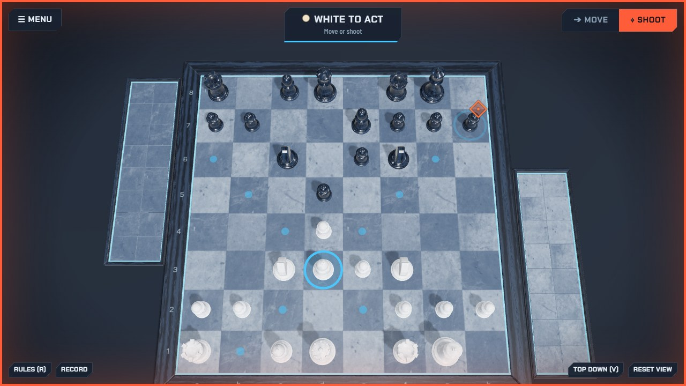
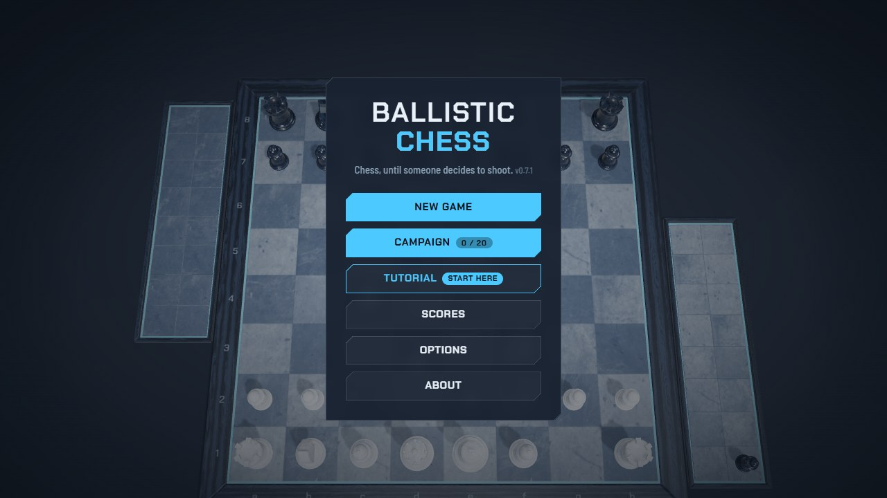
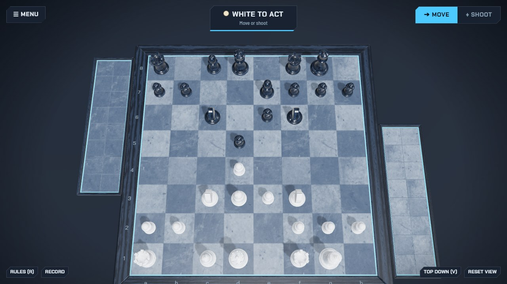

# Ballistic Chess

Ordinary chess, except that on your turn any piece may **shoot** an enemy piece at range instead of moving, along the
lines it already moves on. It is hosted on its own site, **[ballistic-chess.com](https://ballistic-chess.com/)**; this repo
only lists it on the portal shelf (`url` in [`game.json`](game.json): Play opens that site, nothing is built here).

## Features

- A 3D board; each turn, move or shoot. The rook fires an RPG that can freeze a king.
- Play a bot or a friend on the same device (mouse or touch).
- A 20-level campaign, a tutorial, saved games and scores; start from a position code (FEN).

|                                                      |                                               |
| ---------------------------------------------------- | --------------------------------------------- |
|                   |  |
| New game, Campaign, Tutorial, Scores, Options, About | White to act: move or shoot                   |

## Credits and licence

By Deni S. The game is not open source: its code is not in this repo or published anywhere.

Board and piece textures from [Poly Haven](https://polyhaven.com/) (CC0). The cover and screenshots here are
under the repo's [PolyForm Noncommercial](../../../LICENSE) licence; the title in `wordmark.svg` is outlined from
Chakra Petch (SIL OFL 1.1).
