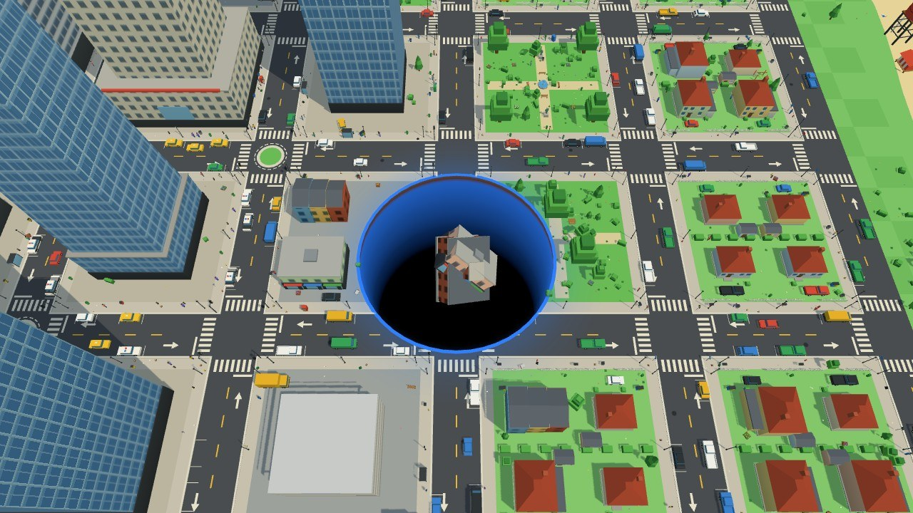
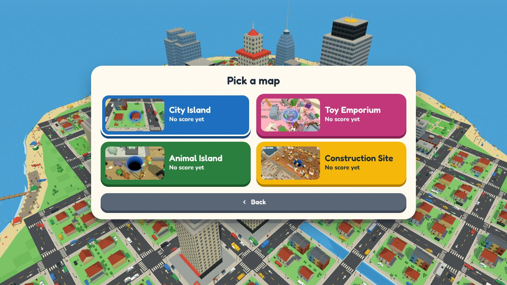
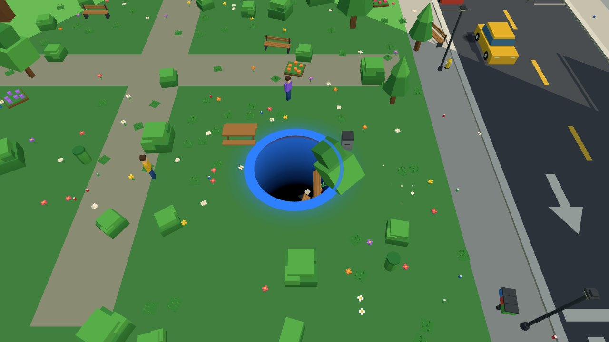
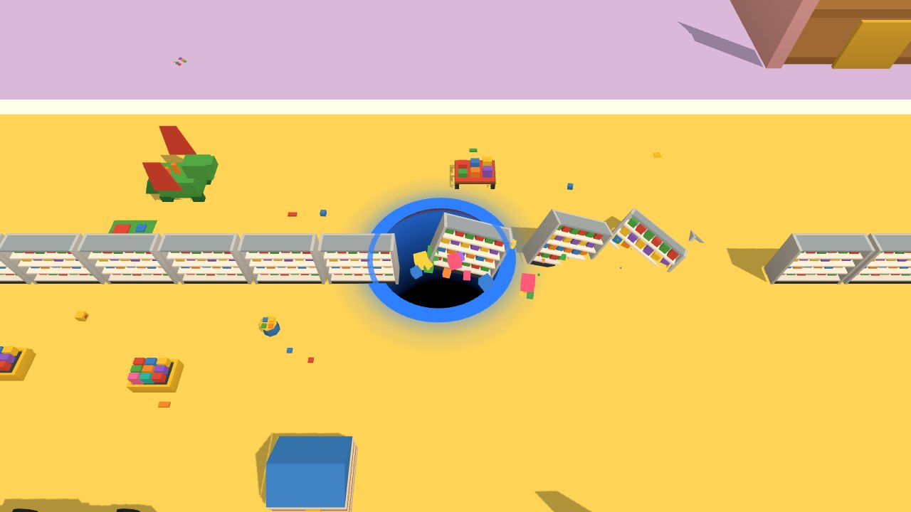
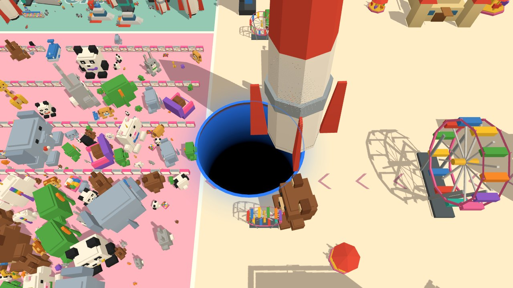
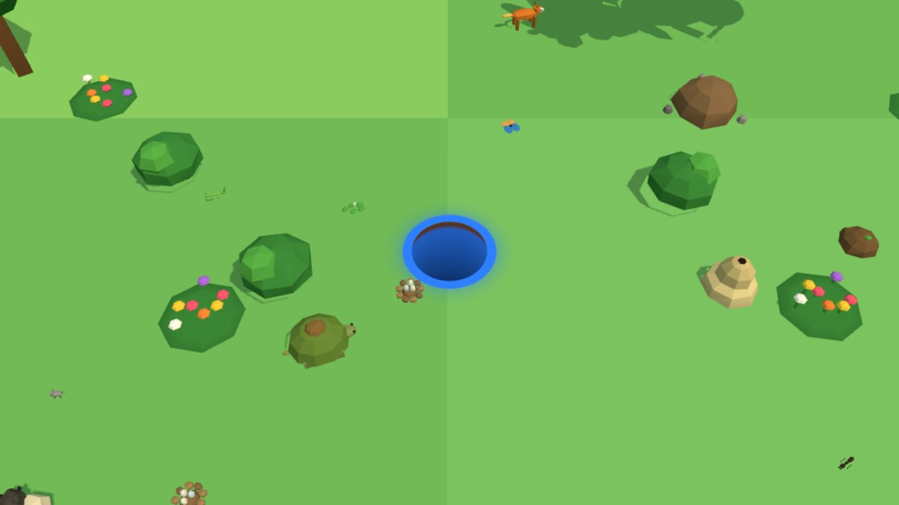
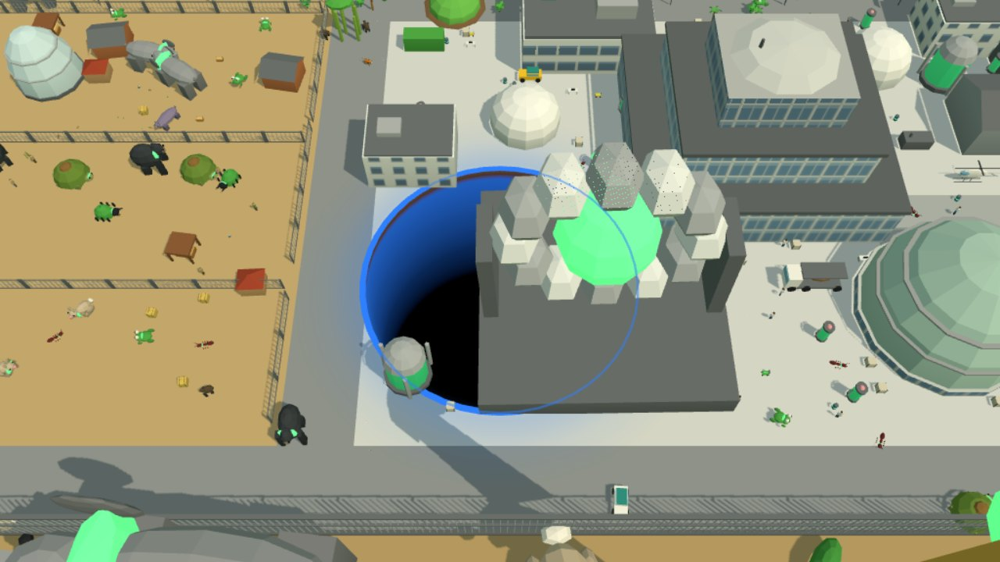
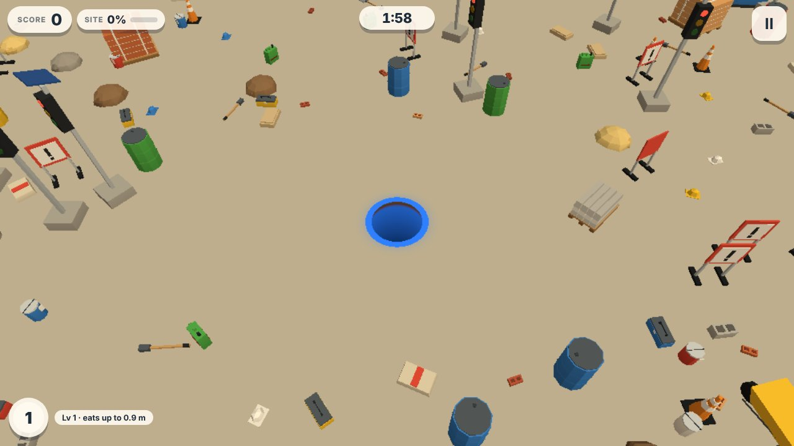
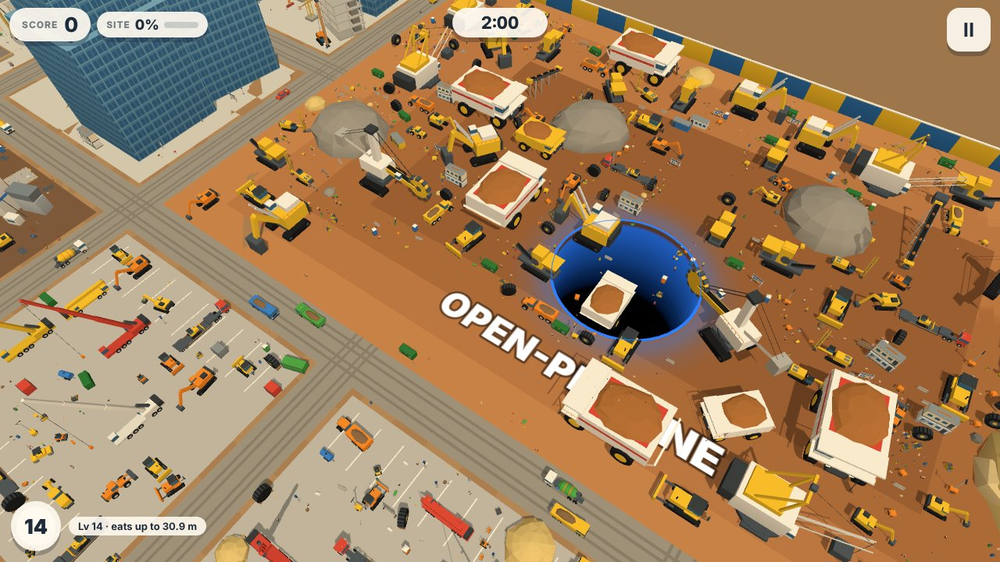

# Hole Island (working title)

A simple game in which you play the role of gravity hole eating the world around you, built with three.js to learn the
library. You steer a gravity hole around a blocky island and swallow everything that fits; every item you eat makes the hole
bigger, from trash cans and flowers up to skyscrapers. You play against the clock and the score goes on a top-10 list
per difficulty. It is a touch-first game (one finger steers), with keyboard, mouse and gamepad support.

All art is original, procedural and made from boxes, and the name is a placeholder.



## Play

```bash
npm run dev     # then open http://localhost:3000/games/hole/
```

Pick a map, a time and a hole colour, then drag to steer. Add `?map=toy`, `?map=animal` or `?map=construction` to jump to a map.

UI look and rules: [STYLEGUIDE.md](STYLEGUIDE.md).

[](STYLEGUIDE.md)

## Maps

|                                                       |                                                      |
| ----------------------------------------------------- | ---------------------------------------------------- |
|             |            |
| **City Island** - a generated toy city, 83 item types | **Toy Emporium** - a giant toy store, 210 item types |



|                                                                                 |                                                          |
| ------------------------------------------------------------------------------- | -------------------------------------------------------- |
|                       |  |
| **Animal Island** - ants, rabbits and zebras first; 37 giant animals, 192 types | The secret zoo and laboratory, where the giants are made |

|                                                                         |                                                                    |
| ----------------------------------------------------------------------- | ------------------------------------------------------------------ |
|     |  |
| **Construction Site** - bricks and cones first, then diggers, 117 types | Haul trucks, cranes and high-rises in the open-pit mine            |

## Features

- Seeded map generators: city districts, roads and beach; a toy store with shuffled departments; an animal island with
  biomes, rivers, edible hills and a secret zoo + lab; a building site with an open-pit mine.
- Moving items: cars drive, people stroll, animals walk, hop, swim and flee, trucks haul.
- Scripted falling / tipping (no physics engine), growth levels with a pulse and a camera that pulls back.
- Every item is built once as procedural geometry; all items of a material are one `BatchedMesh` (a few draw calls per frame for thousands of items).
- Menus, countdown, results and a top-10 list per difficulty, all usable by touch or a controller.
- Tool pages: item viewer, map viewer, balance charts with headless bot runs (dev server).

## Documentation

| Doc                                            | Content                                                                                     |
| ---------------------------------------------- | ------------------------------------------------------------------------------------------- |
| [`DETAILS.md`](DETAILS.md)                     | rules, level / size tables, scoring, item catalog, map generator, debug tools, architecture |
| [`STYLEGUIDE.md`](STYLEGUIDE.md)               | UI look: tokens, type, components, the per-map accent                                       |
| [`TOY-STORE.md`](TOY-STORE.md)                 | Toy Emporium: design, roster, open tasks                                                    |
| [`ANIMAL-ISLAND.md`](ANIMAL-ISLAND.md)         | Animal Island: design, roster, open tasks                                                   |
| [`CONSTRUCTION-SITE.md`](CONSTRUCTION-SITE.md) | Construction Site: design, roster, open tasks                                               |

Educational, non-commercial project; see the repository root for credits.
