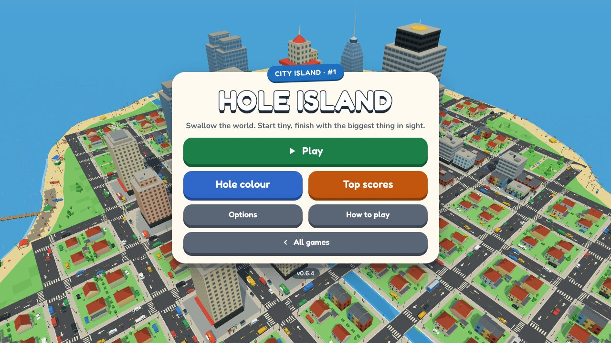
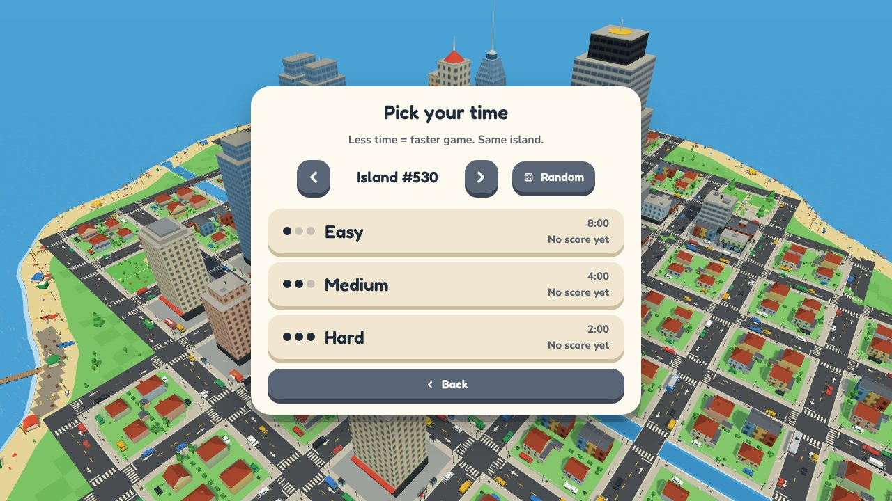
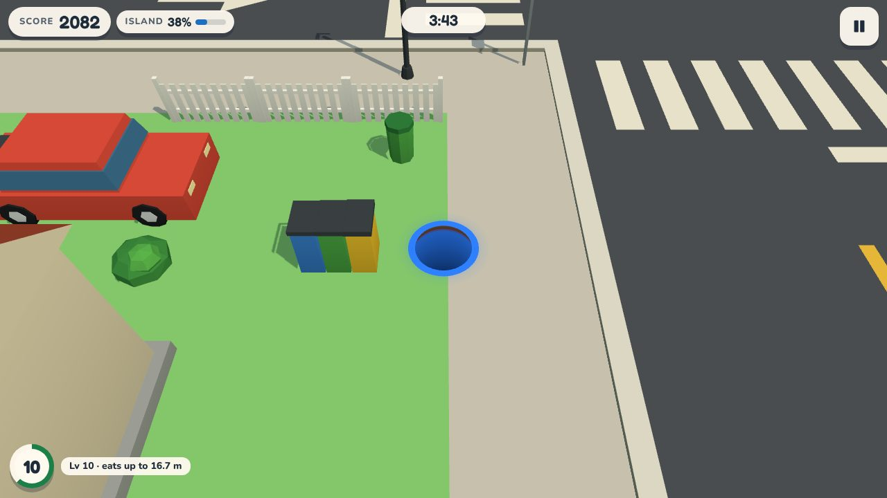
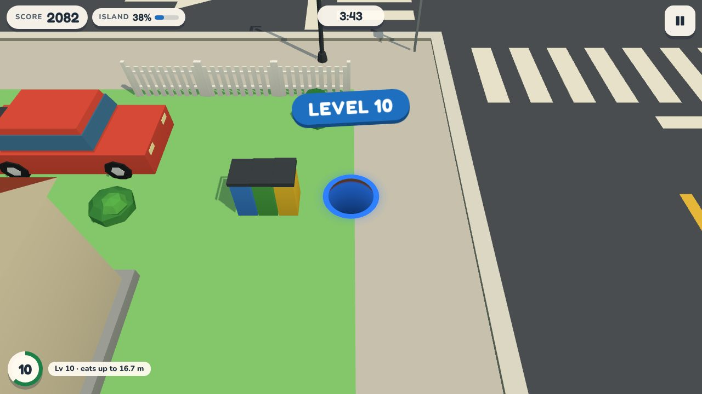
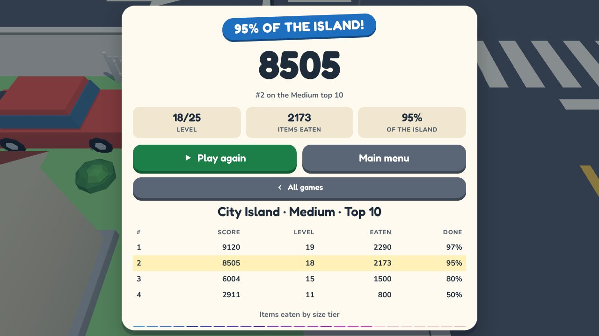
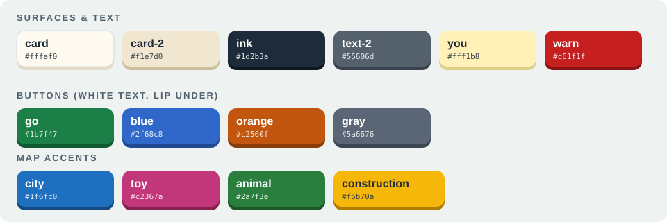

# Hole Island UI style guide

The look of the menus, the HUD and the pause / results screens ("Toy Box"): cream cards, chunky press-down buttons, a rounded
display face and one accent colour per map. All values live in [`game/ui-tokens.css`](game/ui-tokens.css); `hole.css` uses
`var(--hg-*)` only, so a change of look starts there.

| Welcome                                | Pick a map                           | Pick your time                         |
| -------------------------------------- | ------------------------------------ | -------------------------------------- |
|  |      |        |
| **On a run**                           | **Level up**                         | **Results**                            |
|          |  |  |

## Principles

- **The 3D island is the hero.** Cards are small and centred, the colour screen docks its card at the bottom, and the live
  island stays visible behind every menu.
- **Press-down buttons.** A solid fill with a same-hue lip underneath; the lip is the shadow and shrinks when pressed.
- **A plate under every HUD number.** Cream pills read on grass, asphalt, pink toy floor and dirt alike; never bare text over the world.
- **One meaning per colour.** Map colours mean maps, button colours mean actions, difficulty is shown with 1-3 pips (never traffic-light fills).
- **Text never relies on opacity.** Secondary text is `--hg-text-2`, not ink at 60%.
- **Never hide an explanation by screen size.** When a screen runs out of room, show fewer things at once, not less text.

## Colour

|                                              | Token                                | Value                         | Use                                             |
| -------------------------------------------- | ------------------------------------ | ----------------------------- | ----------------------------------------------- |
|                    | `--hg-ink`                           | `#1d2b3a`                     | text, title outline, selected tab               |
|              | `--hg-text-2`                        | `#55606d`                     | secondary text and labels (6.2:1 on the card)   |
|                  | `--hg-card`                          | `#fffaf0`                     | cards, level badge                              |
|              | `--hg-card-2` / `-lip`               | `#f1e7d0` / `#cdbf9e`         | stat boxes, tabs, time buttons                  |
|                    | `--hg-you`                           | `#fff1b8`                     | your row in a score table                       |
|                  | `--hg-warn` / `--hg-warn-bg`         | `#c61f1f` on `#ffe1dd`        | timer in the last 10 seconds                    |
|                      | `--hg-go` / `-lip`                   | `#1b7f47` / `#105a31`         | Play, Resume, Play again; the level ring        |
|                  | `--hg-blue` / `-lip`                 | `#2f68c8` / `#1f4a93`         | Hole colour, Options                            |
|              | `--hg-orange` / `-lip`               | `#c2560f` / `#8a3c08`         | Top scores, Restart                             |
|                  | `--hg-gray` / `-lip`                 | `#5a6676` / `#3d4754`         | Back, Options, How to play, About, arrows       |
|                  | `--hg-city` / `-lip` / `-on`         | `#1f6fc0` / `#14497f` / white | City Island: sea blue                           |
|                    | `--hg-toy` / `-lip` / `-on`          | `#c2367a` / `#86224f` / white | Toy Emporium: toy pink                          |
|              | `--hg-animal` / `-lip` / `-on`       | `#2a7f3e` / `#1b5628` / white | Animal Island: leaf green                       |
|  | `--hg-construction` / `-lip` / `-on` | `#f5b70a` / `#b07f00` / ink   | Construction Site: safety yellow, with ink text |

Every button fill passes 4.5:1 with white text (go 5.0, blue 5.3, orange 4.5, gray 5.8); the map fills pass too (5.0-5.1, and
ink on safety yellow 8.0). Check a new fill the same way before adding it.

### Per-map accent

`data-map="<id>"` on the game root (set in `HoleGame.setMap`) remaps `--hg-map`, `--hg-map-lip` and `--hg-on-map`. These drive
the welcome ribbon, the map tile (via `.hg-map-<id>`, so all four show at once in the picker), the level-up and cleared banner,
the HUD completion bar and the results headline. Buttons and the level ring stay on the shared palette, so a map never changes
what Play looks like. A new map adds its four tokens to `ui-tokens.css` and a `[data-map]` rule + `.hg-map-<id>` rule.

## Type

- **Display:** Fredoka 600 / 700 for the title, headings, buttons, HUD plates and numbers.
- **Body:** Nunito 700 / 800 for body text, labels and tables.
- **Numbers:** score, timer, percent and tables use tabular numerals (`font-variant-numeric: tabular-nums`) so digits do not jitter.
- Fonts are self-hosted (latin + latin-ext woff2, [`assets/fonts/`](assets/fonts/), SIL Open Font License, see
  [`THIRD-PARTY.md`](../../../THIRD-PARTY.md)). Nothing depends on an OS font; the fallbacks only cover loading.
- Sizes: title 34-58 px, headings 28 px, buttons 17-26 px, HUD plates 22-26 px, body 15-17 px, labels 13-15 px. Nothing below 12 px.

## Shape and components

- **Card** (`.hg-card`, `.wide`, `.picker`): cream, radius 28 px, a 10 px hard shadow; a card taller than the screen scrolls
  and its last action row (Back, Play ...) stays in view.
- **Button** (`.hg-btn`): radius 18 px, 56 px tall (`.small` 44 px), colour set by `--b` and its lip by `--l` (`.blue`,
  `.orange`, `.gray`; Play is the default). `:active` drops it 4 px. An icon goes in front of the label.
- **Ribbon** (`.hg-ribbon`): map-coloured pill tilted -2deg on the welcome card, "City Island · #5".
- **Map tile** (`.hg-map`): the map's own colour, its picture, name and best score. Always a 2x2 grid, no scrolling; the
  chosen map has a cream frame. The blurb is the tile's tooltip.
- **Time button** (`.hg-diff`): cream bar with 1-3 ink pips for the difficulty, name, time and best score.
- **Title** (`.hg-title`): white Fredoka with an ink outline and a hard ink shadow.
- **Result headline** (`.hg-result-head`): map-coloured pill that follows the run: "STORE CLEARED!", "95% OF THE STORE!" (half
  or more) or "TIME'S UP!".
- **Icons** ([`game/icons.ts`](game/icons.ts)): play, pause, back, next, check, dice; inline SVG on a 20 px grid in
  `currentColor`, never emoji or text glyphs.

## HUD

- Top left: score plate, and the completion plate with a bar in the map colour. Top centre: the timer; it turns red on cream
  in the last 10 seconds. Top right: the pause button (56 px).
- Bottom left: the level badge (progress ring) and an "eats up to" plate.
- "+N" pop-ups keep the item-size colours (white to coral); the "LEVEL N" and cleared banners use the map colour, tilted -3deg.

## Overlays and results

- **Pause** is a card over a dimmed view with the same buttons. **Results** is a wide card: headline, score, stats, the two
  actions, then the top 10, and the size-tier chart only after a run that reached three or more tiers.
- An empty top 10 shows its message without a header row. Older scoring versions stay dimmed under their divider.

## Layout rules

- Small screens: the action buttons and the version label stay visible; the mobile game is landscape only (check 915x412).
- The same UI in two places shares code (back button, score table).
- Motion: banners, pop-ups and the countdown are the only animation; under `prefers-reduced-motion` the blink and bump stop
  and pop-ups and banners only fade.

## Adding UI

1. Take colours, fonts and radii from `ui-tokens.css`; add a token before adding a literal.
2. Check contrast of new text colours against the card (4.5:1) and of new fills with white text.
3. Check 1280x720 and 915x412 screenshots, and keyboard, pad and touch focus.
4. Update this file when a token or a component changes (a colour token: also its swatch in [`styleguide/`](styleguide/) and
   `palette.svg`); retake the screenshots above when a screen's look changes (`screenshots/ui-*.jpg`, 1280x720, taken in game
   with `?mute=1`).
