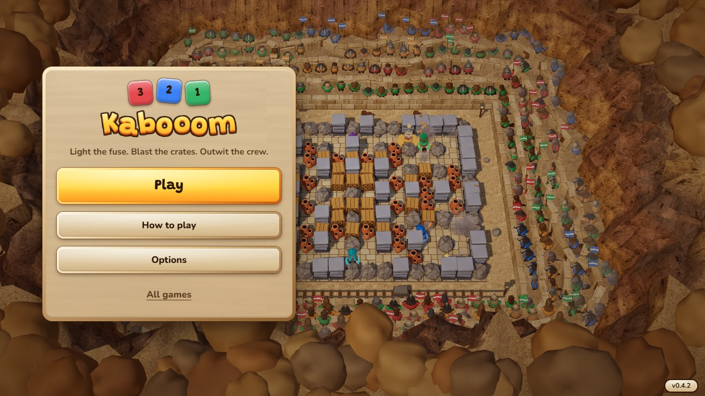
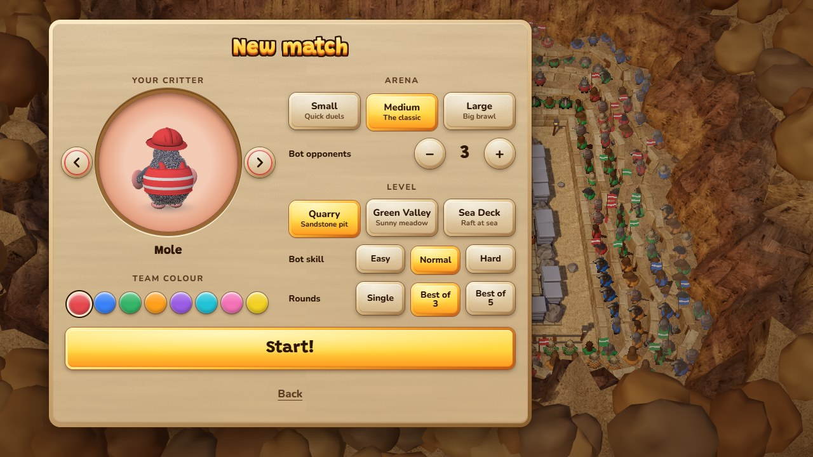
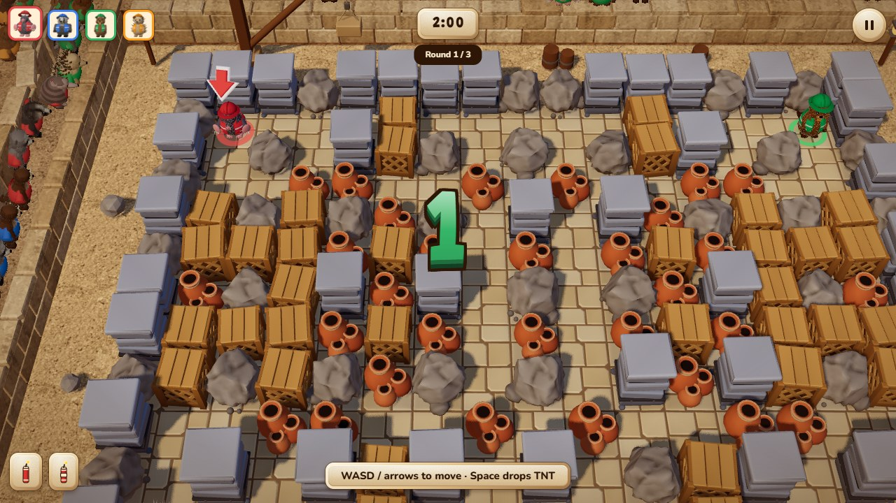
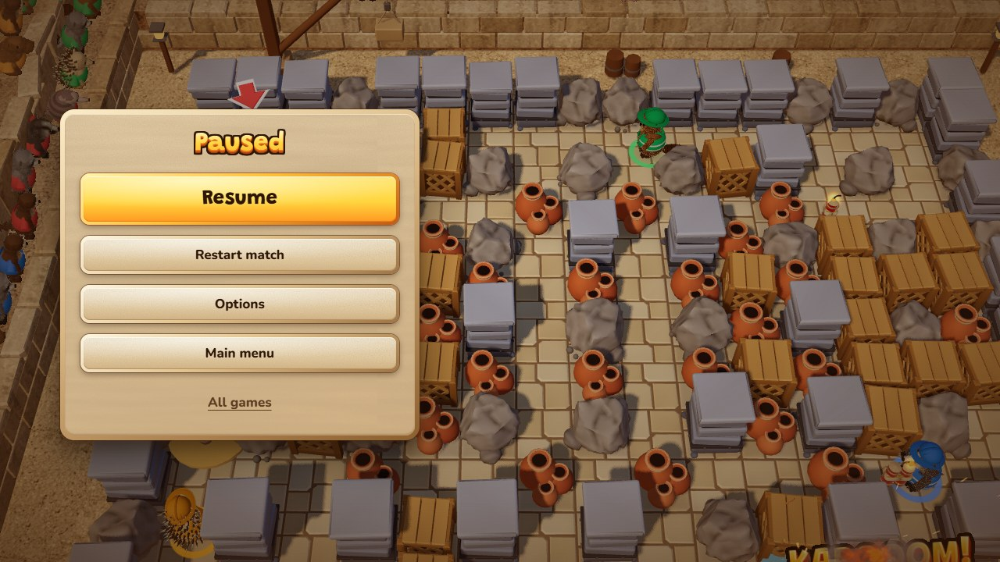
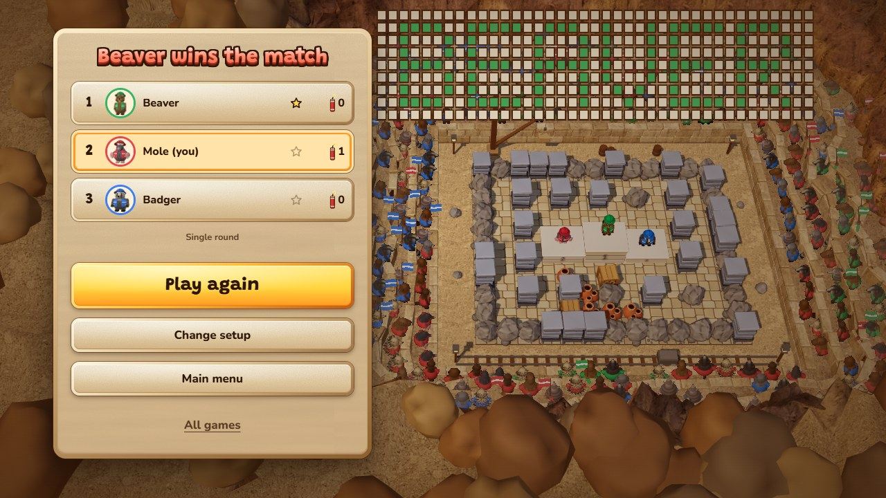
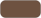

# 3, 2, 1 Kabooom UI style guide

The look of the menus, the HUD and the pause / results screens ("Sandstone"), matched to the arena's mid-poly art: cards are
carved blocks of the quarry's sandstone, buttons and HUD plates are mid-poly tiles bevelled all round, and titles are chunky 3D
letters like the blast words. All values live in [`game/ui-tokens.css`](game/ui-tokens.css); `kaboom.css` uses `var(--kb-*)`
only, so a change of look starts there.

| Welcome                                | New match                              | The count                          |
| -------------------------------------- | -------------------------------------- | ---------------------------------- |
|  |      |  |
| **Paused**                             | **Results**                            |                                    |
|      |  |                                    |

## Principles

- **The arena is the hero.** Cards are small, sit on the left of a wide screen (a bottom sheet on a narrow portrait one) and the
  live bot match stays visible behind every menu. The HUD hides while a card is up.
- **Real material, lit from the top left.** Stone grain and strata, a convex face inside a chamfer that runs round all four
  sides (light top-left, shade bottom-right), a thin rim and a soft contact shadow; no ink outlines on shapes (only on the 3D
  letters). Nothing wobbles; motion is only the press, the card coming in and the banners.
- **One shape for every button.** A sandstone tile; hover lifts it (a longer shadow), the press sets it down. The primary action
  and a chosen segment are the same tile in the blast-word yellow-orange.
- **A plate under every HUD item.** Chips, plates and the round counter sit on stone or ink, so they read on sand, grass and sea;
  no bare text over the world.
- **Colour means a team or an action.** Team colours (the eight in `characters.ts`) mean players, yellow-orange means "do this",
  ink means text and outlines. The 3D letter colours are for titles, banners and the count only.
- **A match ends on a stage.** The camera pulls back, a podium rises, the crew climbs it and the crowd holds up cards; the
  results card opens a moment later.

## Colour

|                                                                        | Token                                       | Value                             | Use                                                                      |
| ---------------------------------------------------------------------- | ------------------------------------------- | --------------------------------- | ------------------------------------------------------------------------ |
|                                              | `--kb-ink`                                  | `#2e1606`                         | text, the 3D letters' outline, the focus ring                            |
|                                          | `--kb-ink-2`                                | `#5a3a20`                         | secondary text (5.2:1 on the darkest part of the card)                   |
|                                            | `--kb-card-hi` / `--kb-card` / `-lo`        | `#eed6aa` / `#e2c491` / `#d9b47e` | the card's slab (`--kb-slab`, ink on it 8.7:1 or more)                   |
|                                  | `--kb-card-edge`                            | `#9a6631`                         | the ring round the critter stage                                         |
|                                              | `--kb-btn` / `-mid` / `-lo`                 | `#f6e8cb` / `#e9cf9f` / `#d8b67f` | buttons, HUD plates, result rows (`--kb-stone`)                          |
|   | `--kb-chamfer-1..3`, `-accent-*`, `-card-*` | light / mid / shade               | the bevel round a tile, a yellow tile, the card                          |
|                                      | `--kb-btn-off`                              | `#cdb08a`                         | disabled button, empty TNT                                               |
|                                        | `--kb-accent-hi` / `--kb-accent` / `-lo`    | `#ffe36a` / `#ffd640` / `#ff9a22` | primary button, chosen segment (`--kb-gold`), focus ring (ink on it 8:1) |
|                                              | `--kb-you`                                  | `#ffe3a8`                         | your row in the results                                                  |
|                                              | `--kb-tnt`                                  | `#d8362f`                         | the TNT button and the dynamite icon                                     |
|                | `--kb-face-1..3`, `--kb-side-1..2`          | `#fffad0` `#ffd640` `#ffa126`     | 3D letters: face top to bottom, the side (orange to brown)               |
|                    | `--kb-lose-*`, `--kb-go-*`                  | red, green                        | 3D letters when a bot wins / sudden death, and "GO!"                     |
|                                            | `--kb-page`                                 | `#c9a878`                         | the page behind the game before the first frame                          |

The sudden-death timer (`--kb-sudden`, `-2`) has its own tokens. Check a new text colour against `--kb-card-lo` (4.5:1) and a
new fill against its text before adding it.

## Type

- **Display:** Grandstander 800 for the logo, headings, the primary button, the rank numbers and the banners.
- **Body:** Nunito 700 / 800 for body text, buttons, labels and tables.
- **Numbers:** timers and tables use tabular numerals so digits do not jitter.
- Fonts are self-hosted (latin + latin-ext woff2, [`assets/fonts/`](assets/fonts/), SIL Open Font License, see
  [`THIRD-PARTY.md`](../../../THIRD-PARTY.md)). Nothing depends on an OS font; the fallbacks only cover loading.
- Sizes: logo 38-54 px, headings 34 px, primary button 24 px, buttons 17 px, labels 13-15 px. Nothing below 12 px.

## Shape and components

- **3D letters** (`.kb-word span`, `.kb-card h2`, `.kb-banner-t`): the face is the text's own gradient (`background-clip:
text`), the side is four drop-shadows stepping down-right and the outline four more in ink, as in the blast words
  ([`render/fx/word-burst.ts`](render/fx/word-burst.ts)). A variant only swaps `--kb-face-*` / `--kb-side-*`; `--kb-step` and
  `--kb-letter-rim` set the depth and the outline.
- **Tile finish** (every button, plate, row and the card): the face is the background's `padding-box` layers, the chamfer its
  `border-box` gradient showing through a transparent border (`--kb-chamfer`, 4 px; the card 6 px), plus `--kb-bevel` (the
  crease), a 1 px `--kb-rim` and a `--kb-contact` shadow. Round pieces (swatches, logo blocks, TNT) use `--kb-block-bevel`.
- **Card** (`.kb-card`): the sandstone slab (`--kb-slab`: grain, strata, a light-to-shade gradient) in its chamfer, 18 px
  radius, a contact shadow and a soft drop shadow, drawn on a `::before`. A card taller than
  the screen scrolls inside the menu layer and its action row (`.kb-actions`) stays in view, on a grain backing on short screens.
- **Logo** (`.kb-logo`): the 3, 2, 1 blocks in red, blue and green (chamfered tiles, tilted) and "Kabooom" in 3D letters.
- **Button** (`.kb-btn`): 12 px radius, 48 px tall (primary 58 px). `--kb-lip` sets the shadow's reach: hover lifts it,
  `:active` sets the tile down. A yellow tile only swaps `background` and `--kb-tile`. Round variant for the arrows (a ring in
  your team colour inside the rim), stepper and pause. Focus is a yellow ring on an ink ring.
- **Spacing:** stacked buttons sit 14 px apart (`.kb-actions`, card gap), segments 10 px.
- **Segmented choice** (`.kb-seg` / `.kb-segbtn`): the same tile; the chosen one is yellow-orange and set down
  (`aria-pressed`). Arena, level, skill and rounds use it. "Match rules ›" expands the level, skill and rounds inline.
- **Colour swatch** (`.kb-swatch`): a bevelled team-colour ball; the chosen one is set down with a light and an ink ring.
- **Critter stage** (`.kb-stage`): the live critter turning on a team-coloured disc sunk in a ring of darker stone; a still portrait
  without WebGL.
- **Icons** ([`game/icons.ts`](game/icons.ts)): the star, the dynamite stick and the pause bars, inline SVG with their colours
  from `ICON_COLORS` (the same values as the tokens); never emoji or text glyphs.

## HUD

- Top left: a chip per player, a rounded-square portrait framed in the team colour; yours is a little bigger, a player who is
  out squashes flat and turns grey (and says "out" in its title). Round wins are stars on an ink pill under the chip.
- Top centre: the timer plate, and "Round 2 / 3" on ink under it. It blinks in sudden death. Top right: the pause button.
- Bottom left: dynamite stock and blast level as icons on plates. Touch: a floating stick and the TNT button.
- The 3 / 2 / 1 count is a big upright 3D number in its logo block's colour, then "GO!" in green. Hints and subtitles are plates.
- Round banners ("You win the round!") are italic 3D letters: yellow for a win, red for a loss or sudden death.

## Overlays and results

- **Pause** is a card over the paused arena (no HUD) with Resume first. **Results** is a card with the headline (red letters
  when a bot won), a row per player (rank, portrait on a team ring, name, stars, blasts), then Play again, Change setup and
  Main menu.
- **The finale** (`WorldView.finale`): the camera pulls back to the whole stand, the arena floor clears, a podium
  (`render/podium.ts`, 2 - 1 - 3, the place pressed into the front) rises and the crew climbs it, the winner hopping. The far
  stand holds up a board of cards that spells "YOU!" or the winner's name in their team colour (`render/card-stunt.ts`; a tie
  lights the board in two colours). The results card docks left on a wide screen and opens 1.2 s after the match ends. A round
  win sends a short wave of coloured cards across the stand.

## Layout rules

- Small screens: the action buttons and the version label stay visible; the mobile game is landscape only (check 915x412).
  On a narrow portrait window the setup and results cards become a bottom sheet with the arena above it.
- Setup fits 1280x720 without scrolling: the critter and colours on the left, the match on the right.
- The same UI in two places shares code (back button, results rows).
- Motion: the card coming in, the press, the dropping count and the pop of a banner; under `prefers-reduced-motion` they stop
  and banners only fade.

## Adding UI

1. Take colours, fonts and radii from `ui-tokens.css`; add a token before adding a literal colour in `kaboom.css`.
2. Check contrast of new text colours against `--kb-card-lo` (4.5:1).
3. Use `.kb-btn` for anything you press, and the tile finish for anything that sits on the world.
4. Check 1280x720 and 915x412 screenshots, and keyboard, pad and touch focus.
5. Update this file when a token or a component changes (a colour token: also its swatch in [`styleguide/`](styleguide/));
   retake the screenshots above when a screen's look changes (`screenshots/ui-*.jpg`, 1280x720, taken in game with `?mute=1`).
