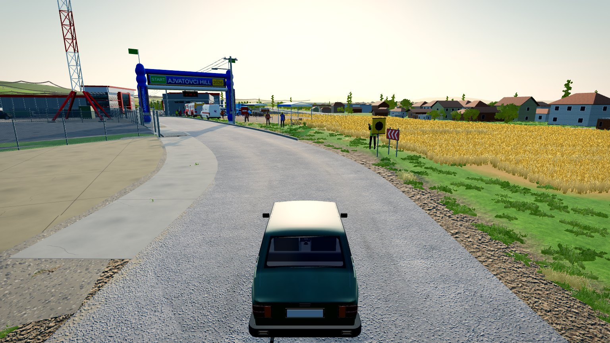
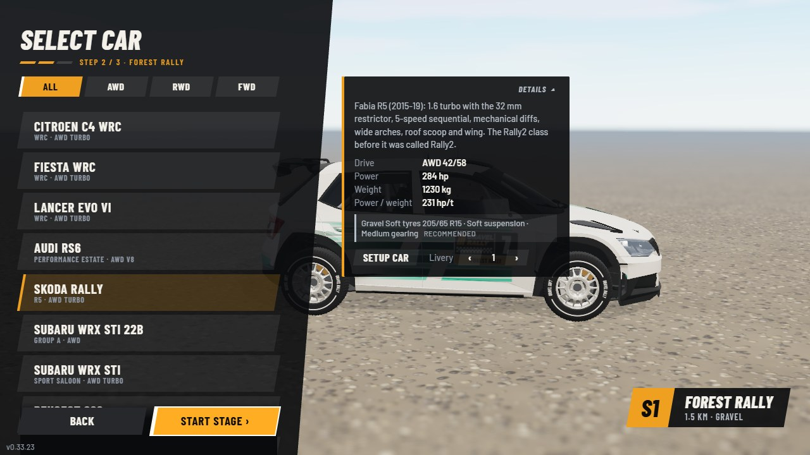
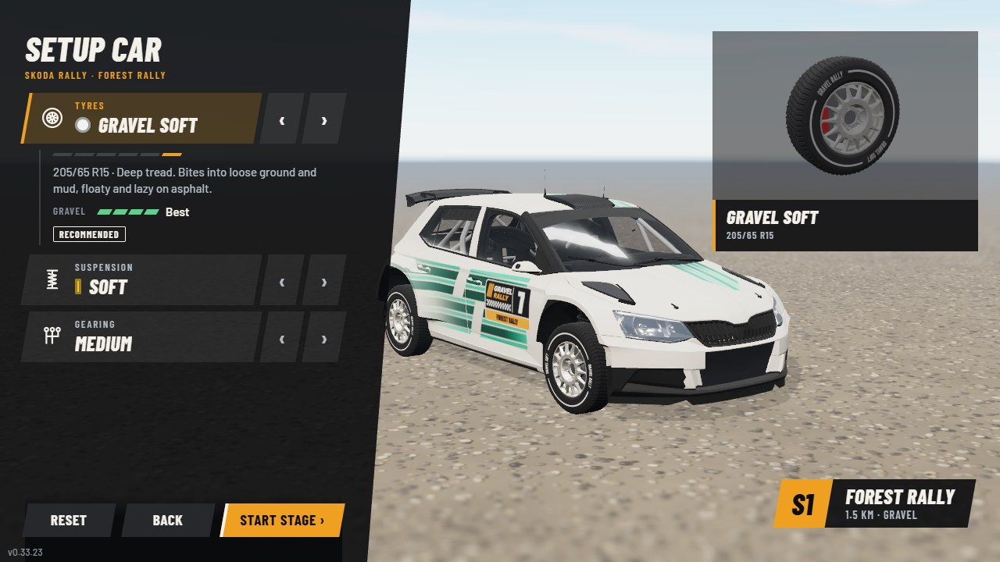
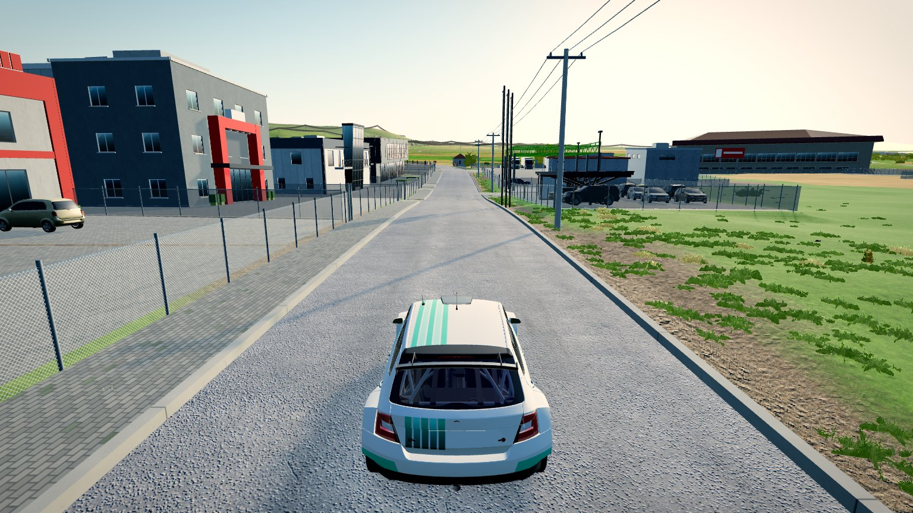
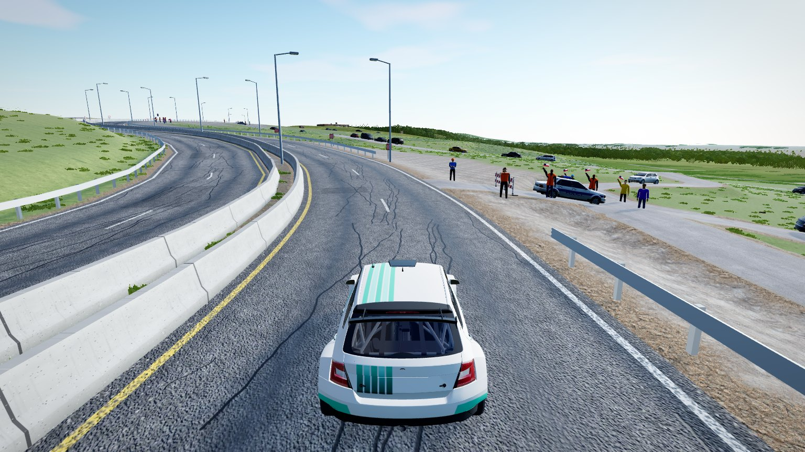
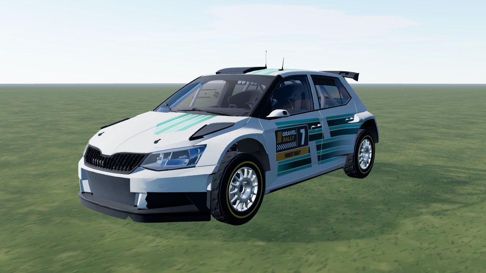
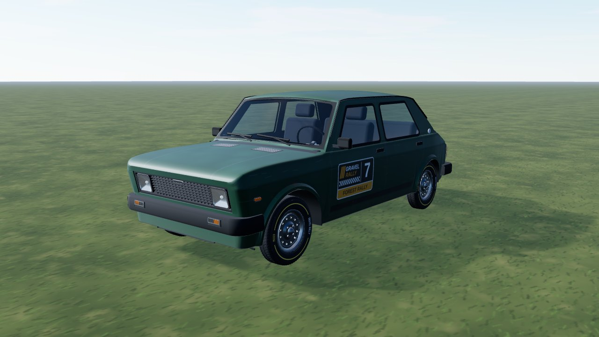

# Gravel Rally

Point-to-point gravel and tarmac rally on **real-world roads**: stages are baked from OpenStreetMap, ESA WorldCover and
elevation data, driven with a custom raycast-vehicle physics model. Built with three.js to learn the library, so the
look is "late-2000s rally game" and the feel is grounded sim-lite that is still fun on a keyboard.



## Play

```bash
npm run dev     # then open http://localhost:3000/games/rally/
```

Menu: select stage (with its time of day: night to evening) -> select car -> (optional) car set-up -> drive.

**Controls:** keyboard (`W` / `S` throttle / brake, `A` / `D` steer, `Space` handbrake, `R` reset to road, `Esc` pause), gamepad
(triggers throttle / brake, left stick steer, menus with the d-pad) and touch (on-screen steer arrows, brake and gas, landscape). All keys
and buttons: [`DETAILS.md`](DETAILS.md) "Controls".

UI look and rules: [STYLEGUIDE.md](STYLEGUIDE.md).

[](STYLEGUIDE.md) [](STYLEGUIDE.md)

## Features

- Real-world stages with bridges, junctions, buildings, power lines and city streets (see maps below); seeded procedural
  vegetation, rocks and props through one instanced asset library, streamed terrain with LODs.
- Five tyres (tarmac and gravel in soft and hard, plus mixed) with a tread pattern per compound, printed sidewall lettering and
  dust that builds up over a run; tyre sizes and class per car, suspension and gearing set-ups, with a live 3D set-up screen.
- Tyre and brake temperature per stage weather (Ajvatovci a hot June morning, Petralica a cool September afternoon): cold tyres
  and pads grip less, hot discs fade; HUD marks for both.
- Replays of every run, saved in the browser: Broadcast, Trackside, chase, bonnet, bumper and Drone cameras, a timeline and speed
  control (video recording on the dev server only).
- Stage timer with sectors, time penalties for cutting and knocking over marker posts, top-10 times per stage (stored locally).
  Tool pages (map viewer, car viewer, asset debugger) on the dev server.

## Stages

| Map                                     | Where                       | Length       | Surface         | Status        |
| --------------------------------------- | --------------------------- | ------------ | --------------- | ------------- |
| [Petralica](maps/petralica/)            | North Macedonia (mountains) | 9.6 km       | gravel + tarmac | playable      |
| [Ajvatovci Hill](maps/ajvatovci/)       | Ilinden, North Macedonia    | 4.5 km       | old tarmac      | playable      |
| [Jackie Robinson Parkway](maps/jackie/) | New York City               | 7.3 km       | tarmac, bridges | playable      |
| [Forest Rally](maps/test/)              | procedural forest           | 1.7 km       | gravel          | physics       |
| [Galichica](maps/galichica/) (3 stages) | Lake Ohrid - Lake Prespa    | 12.7-27.4 km | mountain tarmac | West playable |
| [Vodno Hillclimb](maps/vodno/)          | Skopje, North Macedonia     | 4.0 km       | mountain tarmac | playable      |

[](maps/ajvatovci/) [](maps/jackie/)

## Cars

| Car                                        | Drive | Notes                                                                          |
| ------------------------------------------ | ----- | ------------------------------------------------------------------------------ |
| [Skoda Rally](cars/skoda-rally/)           | AWD   | Fabia R5 from a CC BY Sketchfab model, own livery                              |
| [Bimmer M3](cars/bimmer-m3/)               | RWD   | E46 coupe from a CC BY print STL                                               |
| [Bimmer GT2](cars/bimmer-gt2/)             | RWD   | E92 GT2 racer from a CC BY Sketchfab GLB                                       |
| [Subaru WRX STI 22B](cars/subie-22b/)      | AWD   | 1998 22B coupe from a CC BY Sketchfab GLB, yellow side swoosh                  |
| [Zastava 101](cars/zastava-101/)           | FWD   | hand-built from a blueprint                                                    |
| [Fiesta WRC](cars/fiesta/)                 | AWD   | WRC Fiesta with a visible cockpit                                              |
| [Citroen C4 WRC](cars/citroen-c4/)         | AWD   | 2007 WRC C4 with a visible cockpit                                             |
| [Lancer EVO VI](cars/lancer-evo-6/)        | AWD   | 1999-style Lancer with a visible cockpit                                       |
| [Ford Mustang GT3](cars/ford-gt3/)         | RWD   | 2024 GT3 racer from a CC BY Sketchfab GLB, kept as is                          |
| [Mercedes 190E](cars/merc-190/)            | RWD   | 2.5-16 Evolution saloon from a CC BY Sketchfab GLB, kept as is, badges removed |
| [Peugeot 206](cars/peugeot-206/)           | FWD   | tuned 206 hot hatch from a CC BY Sketchfab GLB, kept as is                     |
| [Audi RS6](cars/audi-rs6/)                 | AWD   | C8 RS6 Avant from a CC BY Sketchfab GLB, kept as is                            |
| [Porsche 911 (930)](cars/porsche-911-930/) | RWD   | 1975 911 Turbo from a CC BY Sketchfab GLB, kept as is (test)                   |
| [Subaru WRX STI](cars/subie-wrx-sti/)      | AWD   | 2019 STI saloon from a CC BY Sketchfab GLB, kept as is                         |
| [Fiat 126p](cars/pezetka/)                 | RWD   | 1970s rear-engined "Maluch" from a CC BY Sketchfab GLB, kept as is             |

[](cars/skoda-rally/) [](cars/zastava-101/)

## Documentation

[`DETAILS.md`](DETAILS.md): pages and URLs, game / stage flow, map engine features, architecture, performance, set-up screen.
[`PHYSICS.md`](PHYSICS.md): vehicle model, tuning guide, tyres and set-ups, test results. Each map and car folder has its own
`README.md` with the overview, sources and licences.

## Credits

Map data: © OpenStreetMap contributors (ODbL), ESA WorldCover 2021 (CC BY 4.0), Copernicus DEM GLO-30, USGS 3DEP,
Microsoft building footprints. Car models and their licences: see each car's README and
[`THIRD-PARTY.md`](../../../THIRD-PARTY.md). Car makes and models are trademarks of their owners; this is a
non-commercial, educational fan project.

Tyre, suspension and brake research (links only): see [`PHYSICS.md`](PHYSICS.md) "Tyre temperature" / "Dampers and bump stop" / "Brakes" and About > Physics in the game.
