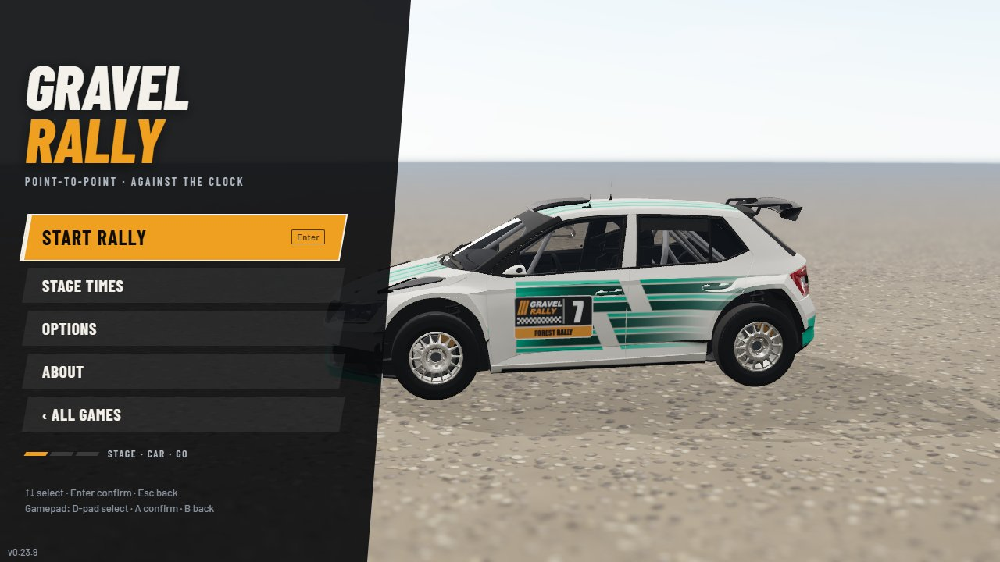
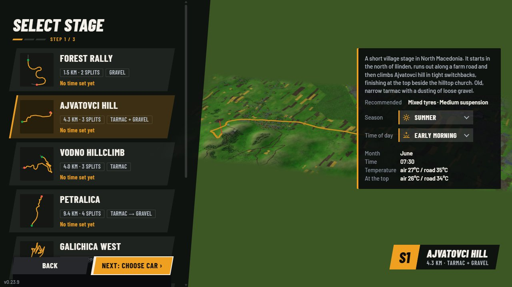
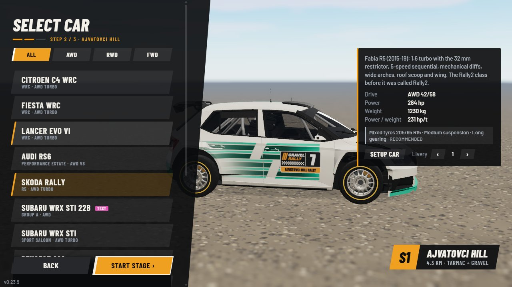
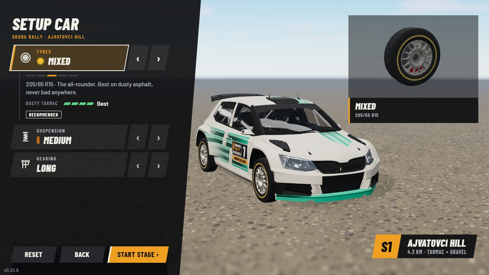
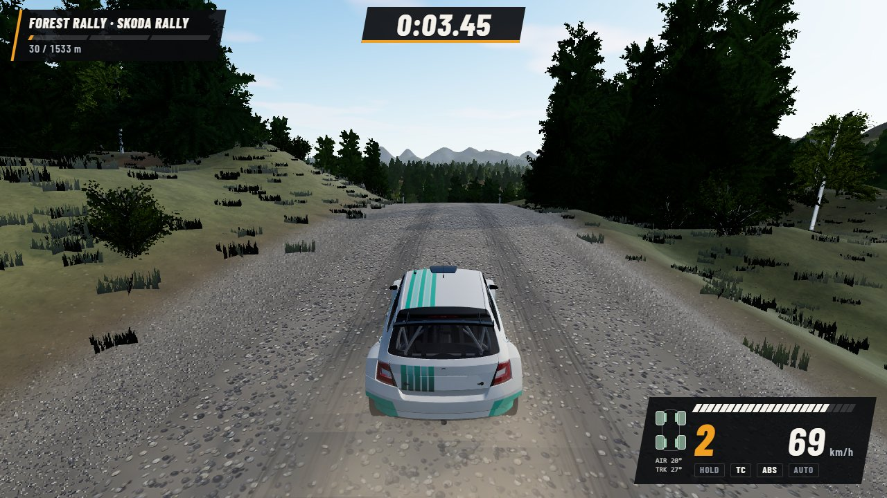
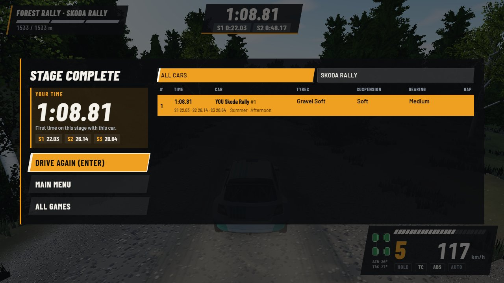

# Gravel Rally UI style guide

The look of the menus, the HUD and the pause / loading / results screens ("Stage Board"). Dark glass over the 3D view, amber
accent, condensed italic type and one 10° slant. All values live in [`game/ui-tokens.css`](game/ui-tokens.css); `menu.css`
and `hud.css` use `var(--ui-*)` only, so a change of look starts there.

| Welcome                                | Select stage                              | Select car                             |
| -------------------------------------- | ----------------------------------------- | -------------------------------------- |
|  |  |   |
| **Setup car**                          | **On a stage**                            | **Results**                            |
|  |             |  |

## Principles

- **The 3D view is the hero.** No card over the middle of the screen on the stage, car and setup screens: the spec card and
  the setup part window dock to the right edge and are narrow, the menu slab stays on the left.
- **One primary action per screen**, a solid amber button. Everything else is a raised glass row.
- **Calm menus, loud moments.** Menus stay flat and dark; the energy goes into the start, the splits and the results.
- **Text sits on a plate.** Every HUD text group has a dark glass plate, never bare text over the sky.
- **Real places.** Stage plates and cards show the stage's own name, length and surface, not decoration.
- **Never hide an explanation by screen size.** When a screen runs out of room, show fewer options at once, not less text
  (tooltips never reach pad or touch players).

## Colour

| Token                               | Value                         | Use                                                                 |
| ----------------------------------- | ----------------------------- | ------------------------------------------------------------------- |
| `--ui-accent` (`-rgb`)              | `#f0a020`                     | brand: primary button, selected edge, active row, route line        |
| `--ui-on-accent`                    | `#0e0d0b`                     | text on an accent fill                                              |
| `--ui-glass` (`--ui-glass-rgb`)     | `#0a0b0d` at 90%              | panels, slab, plates                                                |
| `--ui-raised` / `-hover` / `-solid` | white 7% / 13% / `#26282c`    | button and card fills (`-solid` where text scrolls beneath)         |
| `--ui-line`                         | white 14%                     | hairlines, outlines                                                 |
| `--ui-text` / `-2` / `-off`         | `#f4f1ea` `#b4bcc6` `#8a939f` | primary, secondary, disabled / hints (each at least 4.5:1 on glass) |
| `--ui-best`                         | `#9b4dff` purple              | personal or overall best                                            |
| `--ui-faster` / `--ui-slower`       | `#18a94a` / `#e6b400`         | faster / slower than the reference run                              |
| `--ui-penalty`                      | `#ff5a48`                     | penalties, warnings, redline                                        |
| `--ui-test`                         | `#e04fb3`                     | test-only car / stage badge (dev server)                            |
| `--ui-rate-0` .. `-3`               | red, orange, lime, green      | grip and quality ratings (not timing)                               |

Amber is the brand and never means "good" or "bad": timing meaning only comes from the purple / green / yellow / red set,
ratings from the `--ui-rate-*` set (its orange is not the accent). "Recommended" is a white hairline chip, not green.

## Type

- **Display:** Barlow Condensed, 700 / 800, italic for titles, plates, values and times; uppercase with a little
  letter-spacing for buttons, tags and labels.
- **Body:** Barlow 500, 600 for emphasis.
- **Numbers:** every time, split, speed and distance uses tabular numerals (`font-variant-numeric: tabular-nums`) so digits do not jitter.
- Fonts are self-hosted (latin + latin-ext woff2, [`assets/fonts/`](assets/fonts/), SIL Open Font License, see
  [`THIRD-PARTY.md`](../../../THIRD-PARTY.md) and About > Built with). There is no Cyrillic cut; Cyrillic text falls back to the system font.
- Sizes: titles 34-80 px, stage timer 44 px, buttons 19-26 px, body 13-15 px, labels 12-14 px. Nothing below 12 px.

## Shape and components

- **One slant**, `--ui-slant` (-10°). Buttons, cards, chips, segmented controls, plates and HUD plates draw their fill on a
  skewed `::before`; the text stays upright. Radius 0-2 px, never pill or round (touch pads are the exception).
- **Slab** (`.menu-slab`): the left glass panel with a diagonal right edge; the panel on top of it scrolls, the slab does not.
- **Button** (`.menu-btn`): raised row; hover / focus add the amber left bar; `.primary` is solid amber with a white bar.
  Pad and keyboard focus draw on the skewed fill. The bottom button row (`.menu-buttons`) is opaque glass, so list text never
  shows through it.
- **Card** (`.menu-card`): same as a button; the selected card gets the amber bar and a 20% amber tint (solid amber is for
  primary buttons only, so the second text line stays readable). All cards in a list have one height: tags stay on one row, long text truncates.
- **Segmented control** (`.menu-seg`): slanted chips, the active one amber.
- **Step pips**: three slanted bars (Stage, Car, Go) under the screen title.
- **Stage plate** (`.menu-plate`): bottom right on the stage, car and setup screens and while loading: `S<n>` on amber (the
  stage's place on its map, so only a map with several stages goes past S1), then name, length and surface on glass.
- **Dropdown** (`.menu-select`): native `<select>` (keyboard and phone friendly) with the picked option's amber line icon in
  front, an amber left edge and our own chevron.
- **Icons** ([`game/menu-icons.ts`](game/menu-icons.ts)): 24 px grid line icons, 1.8 px stroke, `currentColor`. Amber in a
  dropdown (season, time of day), white in front of a setup row (tyre, spring, gearbox).
- **Pips** (`.setup-pips`): slanted bars for a rating or an amount. Four lit in the `--ui-rate-*` colour for grip, five white
  for an amount (rebound, pull), amber `.at` pips for which option of a row is picked. Always with the word or number beside them.
- **Recommended** (`.menu-reco`): white hairline chip, no fill.

## Setup car

The menu slab with one slanted row per setting (`.setup-tune`: white icon, label, value, ‹ › arrows):

- ↑↓ pick the row, ←→ or the arrows change it; Enter / A on the active row steps to the next option.
- The active row has the amber bar and tint and opens a detail block under it (`.setup-detail`): which option of the row is
  picked, the description, the numbers with pips, the Recommended chip.
- The part window top right (`.setup-part`) shows the active row's pick live (tyre, coil-over) or the gearing chart, with its
  name on a caption plate. The car stays whole between the slab and the window.
- One primary button: Start stage. Reset and Back are glass.

## HUD

- Stage timer: italic time on a plate, amber underline; split chips under it, green when faster than the reference, yellow when slower.
- Top left: stage name, sector bar (amber running, green / yellow when done), distance, on a plate with an amber edge.
- Bottom right: dash plate with rev bars, gear (amber italic), speed, TC / ABS flags (amber when active).
- Centre messages and the off-stage warning use the display face on a plate or a text shadow.

## Overlays

- **Pause** is the menu slab with the same slanted buttons.
- **Loading** is a centred glass box with the amber edge and a slanted progress bar, over the stage's baked card (aerial picture
  under dark glass), plus the stage plate.
- **Results** is a wide glass box: your time, sector chips, then the stage's best times.

## Layout rules

- Small screens: the action buttons and the version label stay visible; at under 560 px height the logo shrinks, the stage
  plate and hints hide and the setup part window shrinks. The mobile game is landscape only (check 915x412).
- The same UI in two places shares code (options, leaderboard, buttons).
- Motion: one 200 ms ease (`--ui-move`) for hover and focus; nothing animates under `prefers-reduced-motion`.

## Adding UI

1. Take colours, fonts, the slant and the radius from `ui-tokens.css`; add a token before adding a literal.
2. Check contrast of new text colours against `--ui-glass`.
3. Check 1280x720 and 915x412 screenshots, and keyboard, pad and touch focus.
4. Update this file when a token or a component changes; retake the screenshots above when a screen's look changes
   (`screenshots/ui-*.jpg`, 1280x720, taken in game with `?mute=1`).
