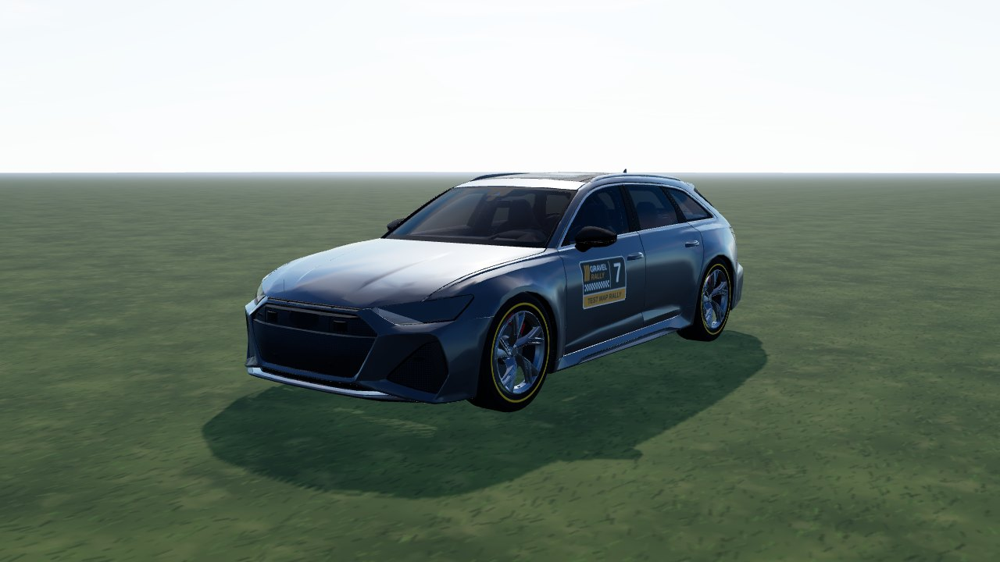
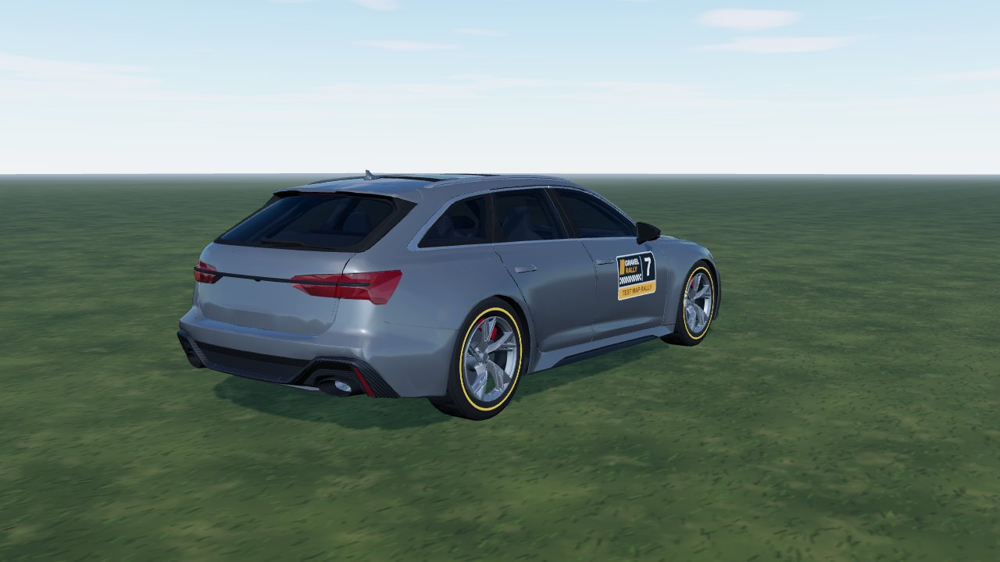
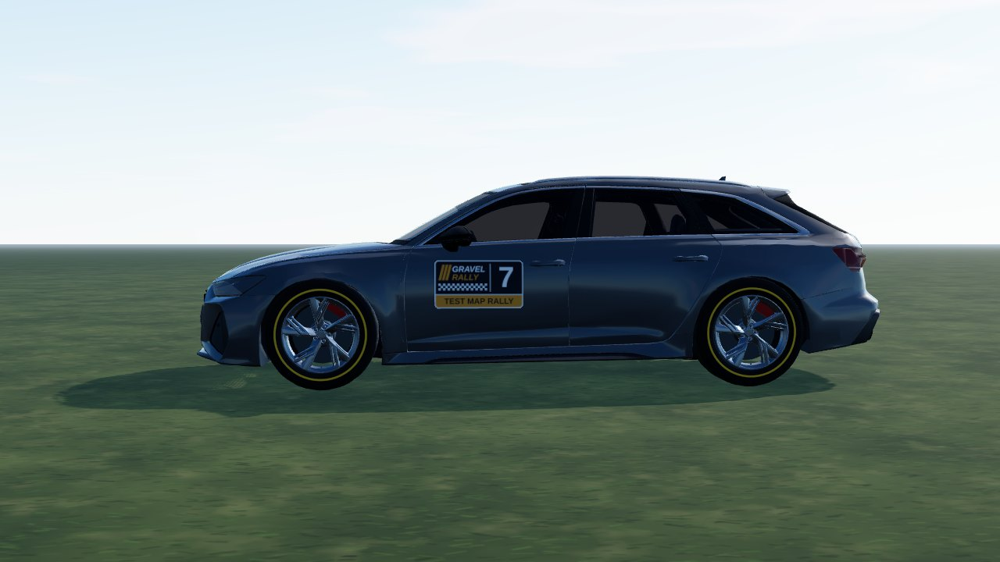

# Audi RS6 (`audi_rs6`)

A C8 RS6 Avant from a **CC BY Sketchfab model**, used as it comes: the model has no livery, so it is mapped to game parts by
material (a few box rules where one material holds two parts). In game it is **Audi RS6**: AWD, 2075 kg, twin-turbo 4.0 V8,
8-speed. Test car (`hideInProd` in `CARS_LIST`).

- **Kept from the model:** the body, the cockpit (flat colours) behind see-through glass, the head / tail lamps with the model's own
  lamp texture and the five double-spoke rim (de-cambered, centred on the hub, lip outside the tyre).
- **Dropped:** tyres, brake discs, calipers and the engine bay, the four rings (front and rear), the RS lettering, the badges and the plate.
- **Paint (ours):** one flat grey, other seeds recolour it; window frames in brushed aluminium (`satin` part).



|                                                |                               |
| ---------------------------------------------- | ----------------------------- |
|  |  |

```bash
npm run dev     # /games/rally/car-viewer.html?car=audi_rs6
```

## Stats (game engine configuration)

Power, torque and mass follow the published RS6 figures; gearing, grip and brakes are estimates.

| Stat       | Value                                                           |
| ---------- | --------------------------------------------------------------- |
| Drivetrain | AWD 40 : 60, 8-speed, final drive 3.2 (short / medium / long)   |
| Engine     | 4.0 V8 twin-turbo, 800 Nm at 2050 - 4500 rpm, 600 hp            |
| Mass       | 2075 kg, wheelbase 2.93 m, track 1.65 / 1.63 m                  |
| Wheels     | 285/35 R21 tarmac, 275/45 R20 mixed, 245/55 R19 gravel          |
| Aids       | ABS, TC like every car (ABS can be switched off in the options) |

## Files

| File                | What                                                                    |
| ------------------- | ----------------------------------------------------------------------- |
| `audi-rs6.ts`       | `CarDef`: physics, hull fitted to the model, rim, glass tint, glTF      |
| `profile.ts`        | boxy side profile baked from the GLB: fallback body and city street car |
| `livery.ts`         | body atlas painter: flat paint over a dark underside                    |
| `model.source.json` | converter settings (offset, atlas) and `gltf` rules (material -> part)  |

## Credits and licence

| What                      | Source                                                                                                                                          | Licence       |
| ------------------------- | ----------------------------------------------------------------------------------------------------------------------------------------------- | ------------- |
| Body, cockpit, lamps, rim | ["Audi RS 6 Avant (C8)" by Mona x Supercars, Sketchfab](https://sketchfab.com/3d-models/audi-rs-6-avant-c8-99aa71f747b0453eb58334414d34397c) | **CC BY 4.0** |

Converted and repainted by us (attribution in `CarDef.credit`, `THIRD-PARTY.md`, `public/models/CREDITS.md`). The downloaded GLB
itself is not in the repository (`sources/` is git-ignored); only the converted `audi_rs6.glb`, `audi_rs6_wheel.glb` and
`audi_rs6_lamps.png` ship.
