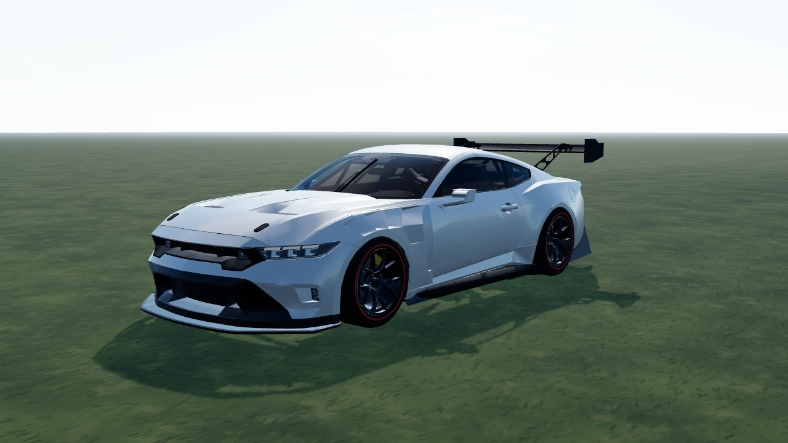
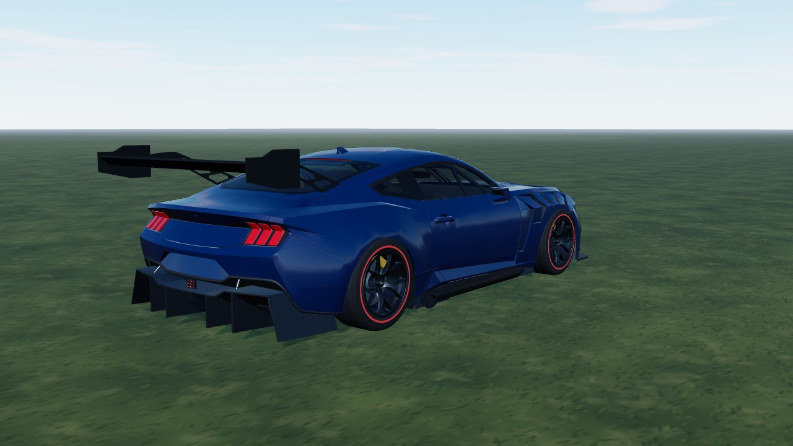
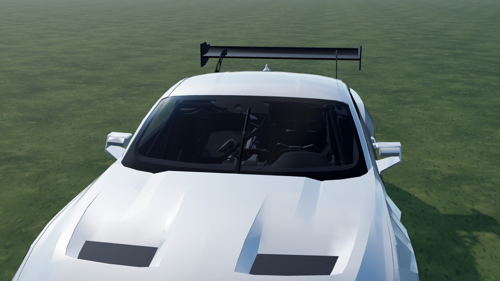

# Ford Mustang GT3 (`ford_gt3`)

A 2024 GT3 racer from a **CC BY Sketchfab model**, used as it comes: the model has no livery and no logos, so it is mapped to game
parts by material only (no cuts). In game it is **Ford Mustang GT3**: RWD, 1300 kg, 5.4 V8, slicks. Test car (`hideInProd` in `CARS_LIST`).

- **Kept from the model:** the body, wing, splitter and diffuser, the cockpit (seats, cage, wheel, dash) behind see-through glass, the
  3D head / tail lamps and the 10-spoke rim (de-cambered, centred on the hub).
- **Dropped:** tyres, brake discs and calipers (the game draws its own), the windscreen banner.
- **Paint (ours):** dark blue with white rear-quarter stripes, a red tail and a light-blue front fender (solid on the vent, stripes towards the door) (seed 0), red wing end plates; other seeds recolour flat. No logos or lettering.



|                                                |                                     |
| ---------------------------------------------- | ----------------------------------- |
|  |  |

```bash
npm run dev     # /games/rally/car-viewer.html?car=ford_gt3
```

## Stats (game engine configuration)

| Stat       | Value                                                            |
| ---------- | ---------------------------------------------------------------- |
| Drivetrain | RWD, 6-speed sequential, final drive 4.4 (short / medium / long) |
| Engine     | 5.4 V8, 640 Nm at 5500 rpm, about 530 hp, redline 7400 rpm       |
| Mass       | 1300 kg, wheelbase 2.73 m, track 1.66 / 1.64 m                   |
| Wheels     | slicks 300/38 R18 front, 310/41 R18 rear; rally compounds as GT2 |
| Aids       | ABS, TC like every car (ABS can be switched off in the options)  |

## Files

| File                | What                                                                    |
| ------------------- | ----------------------------------------------------------------------- |
| `ford-gt3.ts`       | `CarDef`: physics, hull fitted to the model, rim, glass tint, glTF      |
| `profile.ts`        | boxy side profile baked from the GLB: fallback body and city street car |
| `livery.ts`         | body atlas painter: the livery (seed 0) over a dark underside           |
| `fender-mask.ts`    | traced texels of the solid fender blue (re-trace if the atlas changes)  |
| `model.source.json` | converter settings (offset, atlas) and `gltf` rules (material -> part)  |

## Credits and licence

| What                      | Source                                                                                                                                | Licence        |
| ------------------------- | ------------------------------------------------------------------------------------------------------------------------------------- | -------------- |
| Body, cockpit, lamps, rim | ["2024 Ford Mustang GT3" by kevin, Sketchfab](https://sketchfab.com/3d-models/2024-ford-mustang-gt3-d2b7823f48f147e99e857ee825d089cc) | **CC BY 4.0**  |
| Specification             | [Ford Performance - Mustang GT3](https://www.ford.com/performance/mustang-gt3/)                                                       | reference only |

Converted and repainted by us (attribution in `CarDef.credit`, `THIRD-PARTY.md`, `public/models/CREDITS.md`). The downloaded GLB
itself is not in the repository (`sources/` is git-ignored); only the converted `ford_gt3.glb` / `ford_gt3_wheel.glb` ship.
