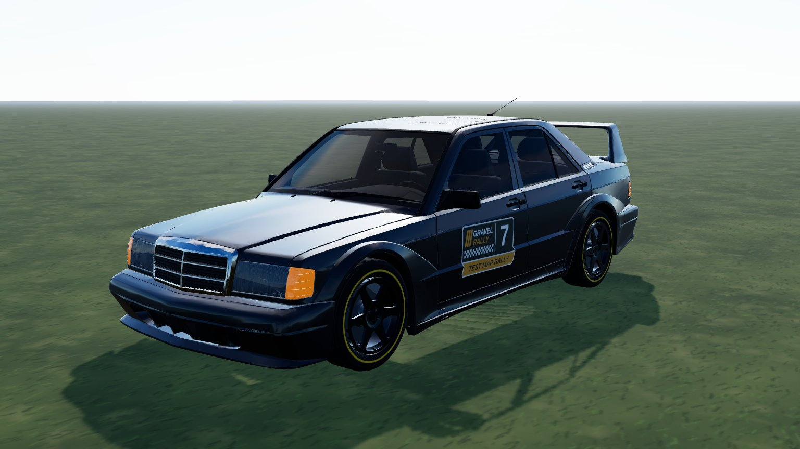
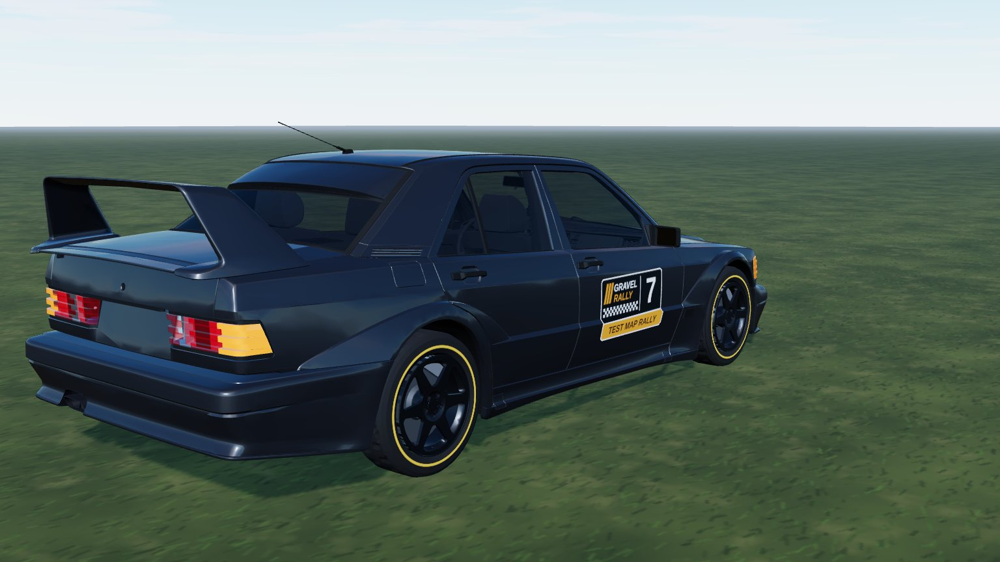
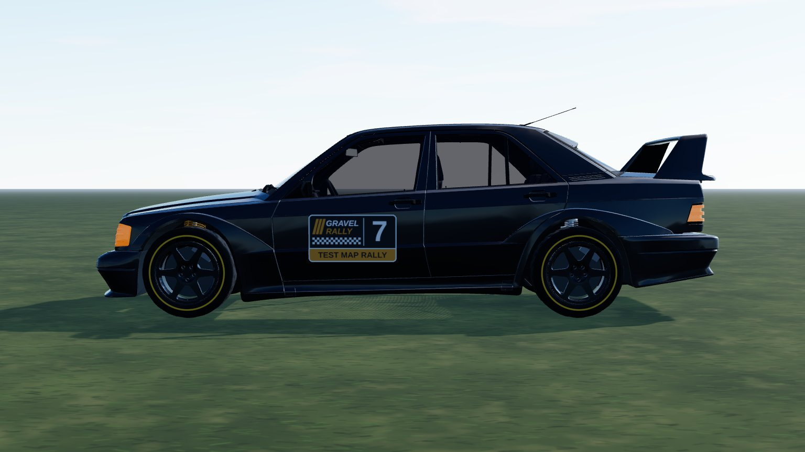

# Mercedes 190E (`merc_190`)

A 2.5-16 Evolution saloon from a **CC BY Sketchfab model**, used as it comes: mapped to game parts by material only (no cuts), no
livery. In game it is **Mercedes 190E**: RWD, 1340 kg, 2.5 l four, five-speed, road tyres.

- **Kept from the model:** the body with its wing and wide arches, the cockpit (seats, dash, wheel) behind see-through glass, the 3D head /
  tail lamps and the 6-spoke rim (de-cambered, centred on the hub).
- **Removed:** the hood star, the grille badge, the three boot-lid badges, the steering-wheel badge and the hub-cap star (flattened).
  Also dropped: tyres, discs, calipers and the model's own springs and arms (the game draws its own wheels and coil-overs).
- **Paint (ours):** one flat dark grey, other seeds recolour it; no logos or lettering.



|                                                |                               |
| ---------------------------------------------- | ----------------------------- |
|  |  |

```bash
npm run dev     # /games/rally/car-viewer.html?car=merc_190
```

## Stats (game engine configuration)

| Stat       | Value                                                                   |
| ---------- | ----------------------------------------------------------------------- |
| Drivetrain | RWD, 5-speed manual, final drive 3.9 (short / medium / long)            |
| Engine     | 2.5 l NA four, 245 Nm at 5000 rpm, about 235 hp, redline 7500 rpm       |
| Mass       | 1340 kg, wheelbase 2.672 m (the model's), track 1.467 m                 |
| Wheels     | road tyres 215/40 R18 front, 225/40 R18 rear; rally compounds as Lancer |
| Aids       | ABS, TC like every car (ABS can be switched off in the options)         |

Power, mass and tyres are our estimates.

## Files

| File                | What                                                                    |
| ------------------- | ----------------------------------------------------------------------- |
| `merc-190.ts`       | `CarDef`: physics, hull fitted to the model, rim, glass tint, glTF      |
| `profile.ts`        | boxy side profile baked from the GLB: fallback body and city street car |
| `livery.ts`         | body atlas painter: flat paint over a dark underside                    |
| `model.source.json` | converter settings (offset, atlas) and `gltf` rules (material -> part)  |

## Credits and licence

| What                      | Source                                                                                                                                                                      | Licence        |
| ------------------------- | --------------------------------------------------------------------------------------------------------------------------------------------------------------------------- | -------------- |
| Body, cockpit, lamps, rim | ["Mercedes 190E EVO 1982 3D Model Free" by Betier Models, Sketchfab](https://sketchfab.com/3d-models/mercedes-190e-evo-1982-3d-model-free-15e5576f4b724f2db357165caed3492b) | **CC BY 4.0**  |
| Specification             | [MotorTrend - 1990 Mercedes-Benz 190E 2.5-16 Evolution II history](https://www.motortrend.com/features/1990-mercedes-benz-190e-2-5-16-evolution-ii-history)                 | reference only |

Converted and repainted by us (attribution in `CarDef.credit`, `THIRD-PARTY.md`, `public/models/CREDITS.md`). The downloaded GLB
itself is not in the repository (`sources/` is git-ignored); only the converted `merc_190.glb` / `merc_190_wheel.glb` ship.
