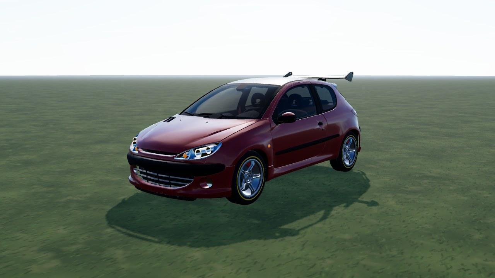
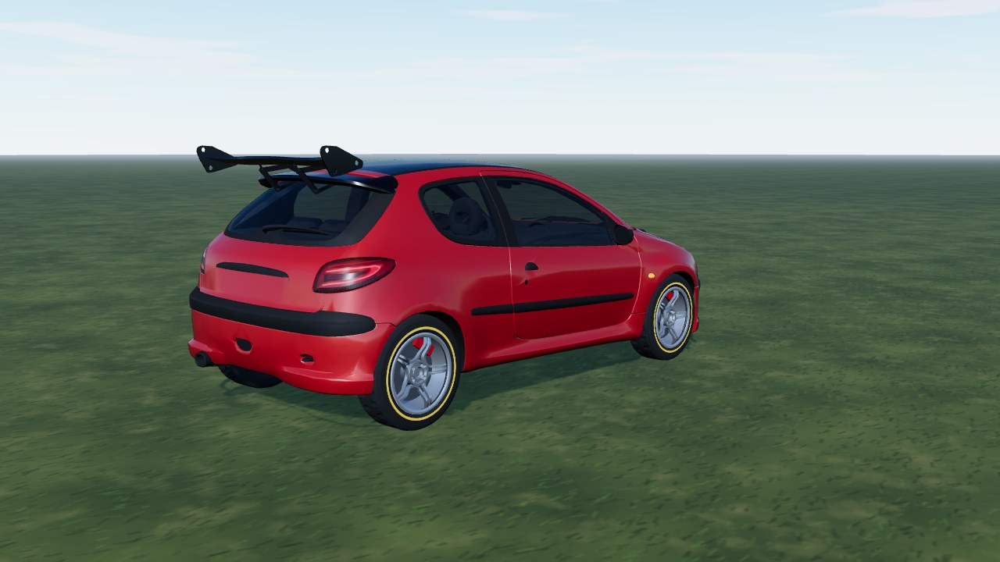
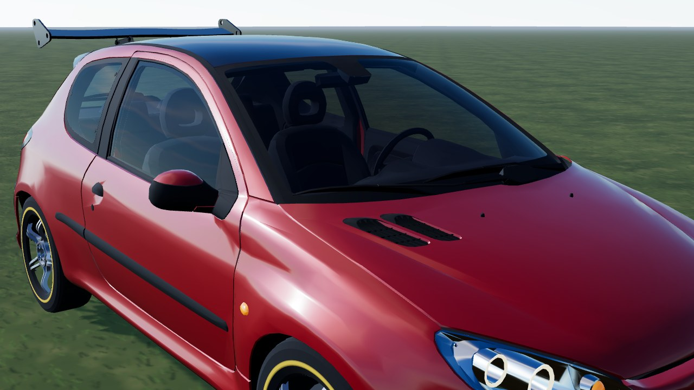

# Peugeot 206 (`peugeot_206`)

A tuned 206 hot hatch from a **CC BY Sketchfab model**, used as it comes: the model has no livery, so it is mapped to game parts by
material only (no cuts). In game it is **Peugeot 206**: FWD, 1100 kg, 2.0 four, 5-speed. Test car (`hideInProd` in `CARS_LIST`).

- **Kept from the model:** the body with its hood vents and roof wing, the cockpit (seats, dash, wheel) behind see-through glass,
  the 3D head / tail lamps and the 5-spoke rim (de-cambered, centred on the hub).
- **Dropped:** tyres, brake discs, calipers and springs (the game draws its own), the lion emblem, the rear lettering, the side badge and
  the centre-cap emblem.
- **Paint (ours):** one flat red (other seeds recolour it); the roof and wing stay gloss black like the model.
- **Tail lamps (ours):** the model has flat colours only, so the lamp meshes get procedural LED-lamp textures (red lens, smoked
  pockets, glowing tubes that light with the brake, a dotted strip that lights white in reverse; `lampclear` / `lampred` in
  `cars/shared/part-materials.ts`).
- **Size:** the model is built small, so it is scaled to the real wheelbase (2.443 m); its flared arches make it about 1.86 m wide.



|                                                |                                     |
| ---------------------------------------------- | ----------------------------------- |
|  |  |

```bash
npm run dev     # /games/rally/car-viewer.html?car=peugeot_206
```

## Stats (game engine configuration)

Power and torque follow the 206 GTi 180 (180 hp, 202 Nm); the mass is an estimate.

| Stat       | Value                                                           |
| ---------- | --------------------------------------------------------------- |
| Drivetrain | FWD, 5-speed manual, final drive 4.3 (short / medium / long)    |
| Engine     | 2.0 16V, 202 Nm at 4750 rpm, 180 hp at 6900, redline 7200       |
| Mass       | 1100 kg, wheelbase 2.443 m, track 1.43 / 1.41 m                 |
| Wheels     | 215/45 R17 tarmac, 205/55 R16 mixed, 195/65 R15 gravel          |
| Aids       | ABS, TC like every car (ABS can be switched off in the options) |

## Files

| File                | What                                                                    |
| ------------------- | ----------------------------------------------------------------------- |
| `peugeot-206.ts`    | `CarDef`: physics, hull fitted to the model, rim, glass tint, glTF      |
| `profile.ts`        | boxy side profile baked from the GLB: fallback body and city street car |
| `livery.ts`         | body atlas painter: flat paint over a dark underside                    |
| `model.source.json` | converter settings (offset, atlas) and `gltf` rules (material -> part)  |

## Credits and licence

| What                      | Source                                                                                                                                                                            | Licence        |
| ------------------------- | --------------------------------------------------------------------------------------------------------------------------------------------------------------------------------- | -------------- |
| Body, cockpit, lamps, rim | ["Peugeot 206" by Alvier, Sketchfab](https://sketchfab.com/3d-models/peugeot-206-dc25a117378545e7a804c8594aa86938)                                                                | **CC BY 4.0**  |
| Specification             | [Stellantis Media - Peugeot GTi through the years](https://www.media.stellantis.com/uk-en/peugeot/press/peugeot-gti-through-the-years-10-icons-that-set-automotive-hearts-racing) | reference only |

Converted and repainted by us (attribution in `CarDef.credit`, `THIRD-PARTY.md`, `public/models/CREDITS.md`). The downloaded GLB
itself is not in the repository (`sources/` is git-ignored); only the converted `peugeot_206.glb` / `peugeot_206_wheel.glb` ship.
