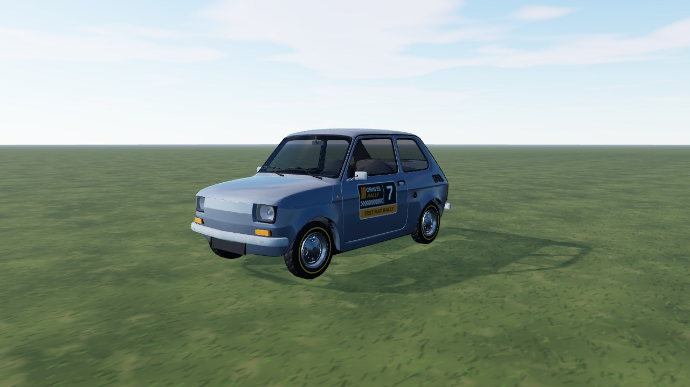
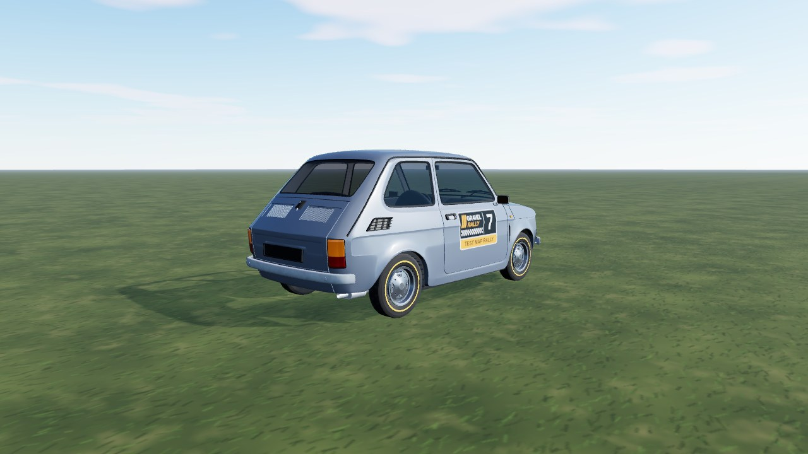
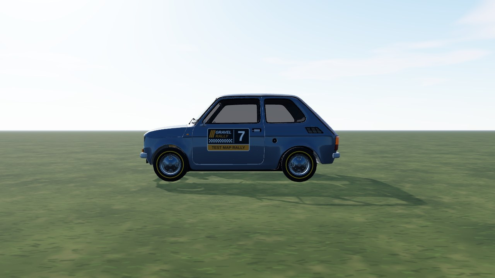

# Fiat 126p (`pezetka`)

A Polish-built Fiat 126p ("Maluch", pronounced "pe-zet-ka") from a **CC BY Sketchfab model**, used as it comes: the model has no
livery, so it is mapped to game parts by material. In game it is **Fiat 126p**: RWD, 600 kg, a 652 cc two-cylinder behind the
rear axle, 4-speed, **no ABS and no traction control**. Test car (hidden in the published build).

- **Kept from the model:** the whole body and cockpit shell (flat colours), the bumpers with their own weathered texture, the
  head lamps with their own reflector sheet, the amber indicators, the two-colour tail lamps (faceted lens) and the steel rim (de-cambered,
  centred on the hub).
- **Dropped:** tyres, the plates, the front badge and the "126p" lettering.
- **Shrunk:** the source is 27 MB (35 textures); the game uses flat paint, so only the bumper and head lamp sheets ship (512 px,
  256 colours). Body 100k triangles, kept at the model's own detail; `normalSmooth` in `model.source.json` irons out the
  ripples that the model's hand-smoothed normals hide.
- **Paint (ours):** one flat period blue-grey, other seeds recolour it.
- **Interior (second model):** the body model's cockpit is only a flat lid at sill height with the seat backs poking
  through, so the dash, steering column and wheel, gear lever, seats, seat rails, rear bench and floor come from
  "fiat 126p" by subishi, with their own textures. Same wheelbase; it is narrowed 5% and lowered to sit under our
  windscreen (`srcParts.from` in `model.source.json`). The black door cards and kick panels are ours (the doors are one-sided skins).



|                                                |                               |
| ---------------------------------------------- | ----------------------------- |
|  |  |

```bash
npm run dev     # /games/rally/car-viewer.html?car=pezetka
```

## Stats (game engine configuration)

Power, torque, mass and size follow the published 652 cc figures; gearing, grip and brakes are estimates.

| Stat       | Value                                                                      |
| ---------- | -------------------------------------------------------------------------- |
| Drivetrain | RWD, open diff, 4-speed, final drive 4.875 (short / medium / long)         |
| Engine     | 652 cc air-cooled twin, 43 Nm at 2500 rpm, 23 hp (17 kW) at 4500 rpm       |
| Mass       | 600 kg, 40 : 60 front : rear, wheelbase 1.84 m, track 1.08 / 1.16 m        |
| Wheels     | 135/70 R12 (145/70 tarmac, 135/75 gravel), 180 mm drums on all four wheels |
| Aids       | none (no ABS, no traction control)                                         |
| Speed      | about 100 km/h flat out, 0-60 km/h in ~10 s on gravel                      |

## Files

| File                | What                                                                    |
| ------------------- | ----------------------------------------------------------------------- |
| `pezetka.ts`        | `CarDef`: physics, hull fitted to the model, rim, glass tint, glTF      |
| `profile.ts`        | boxy side profile baked from the GLB: fallback body and city street car |
| `livery.ts`         | body atlas painter: flat paint over a dark underside                    |
| `model.source.json` | converter settings (offset, atlas) and `gltf` rules (material -> part)  |

## Credits and licence

| What                               | Source                                                                                                                                                   | Licence        |
| ---------------------------------- | -------------------------------------------------------------------------------------------------------------------------------------------------------- | -------------- |
| Body, cockpit, lamps, bumpers, rim | ["Polski Fiat (Fiat 126p)" by Martin Trafas (TinoD2), Sketchfab](https://sketchfab.com/3d-models/polski-fiat-fiat-126p-edc1b9d866484e048b4c54d917cca900) | **CC BY 4.0**  |
| Interior                           | ["fiat 126p" by subishi, Sketchfab](https://sketchfab.com/3d-models/fiat-126p-f44214026ca1454ea4d75755d74334bf)                                          | **CC BY 4.0**  |
| Specification                      | [Fiat 126, Wikipedia](https://en.wikipedia.org/wiki/Fiat_126)                                                                                            | reference only |

Converted and repainted by us (attribution in `CarDef.credit`, `THIRD-PARTY.md`, `public/models/CREDITS.md`). The downloaded GLB
itself is not in the repository (`sources/` is git-ignored); only the converted `pezetka.glb`, `pezetka_wheel.glb`,
`pezetka_metal.png`, `pezetka_lamps.png` and the interior sheets (`pezetka_seats.png`, `pezetka_dash.png`, `pezetka_chrome.png`,
`pezetka_floor.png`) ship.
