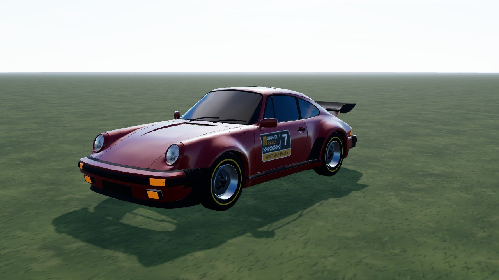
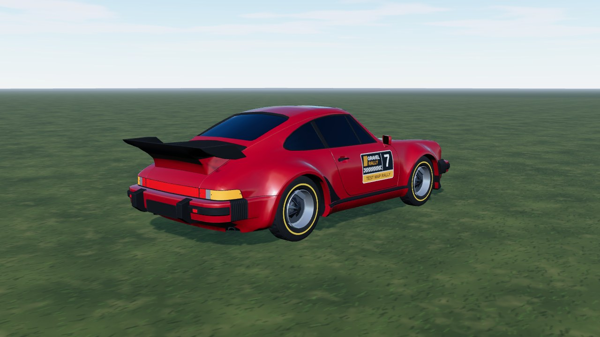
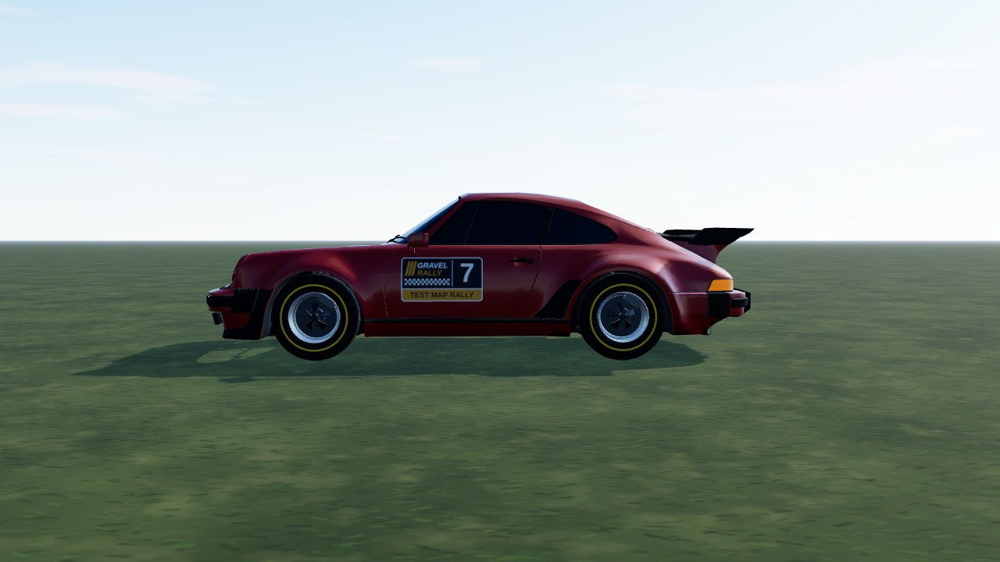

# Porsche 911 (930) (`porsche_911_930`)

A 1975 911 Turbo from a **CC BY Sketchfab model**, used as it comes: the model has no livery, so it is mapped to game parts by
material only (no cuts). In game it is **Porsche 911 (930)**: RWD, 1195 kg, 3.0 turbo flat-six, four gears, period road tyres. Test car
(`hideInProd` in `CARS_LIST`).

- **Kept from the model:** the body with its whale tail and bumpers, the headlamps (with their own texture) and tail lamps, the
  five-spoke rim (de-cambered, centred on the hub), ash-black centre with a silver lip.
- **Dropped:** tyres, brake discs and the wheel nuts (a simpler rim); the wordmark on the rear light strip is now a plain red lens.
- **No interior:** the model is an empty shell, so the windows are tinted.
- **Paint (ours):** one flat red, other seeds recolour it; no logos or lettering.



|                                                |                               |
| ---------------------------------------------- | ----------------------------- |
|  |  |

```bash
npm run dev     # /games/rally/car-viewer.html?car=porsche_911_930
```

## Stats (game engine configuration)

| Stat       | Value                                                                    |
| ---------- | ------------------------------------------------------------------------ |
| Drivetrain | RWD, 4-speed manual, final drive 3.44 (short / medium / long)            |
| Engine     | 3.0 turbo flat-six, 343 Nm at 4000 rpm, 260 hp, redline 6500 rpm         |
| Mass       | 1195 kg (61 % on the rear axle), wheelbase 2.272 m, track 1.43 / 1.455 m |
| Wheels     | 185/70 R15 front, 215/60 R15 rear; rally compounds narrower              |
| Aids       | ABS, TC like every car (ABS can be switched off in the options)          |

Power and torque are the published figures; gearbox ratios, tyre grip and brake sizes are our estimates.

## Files

| File                 | What                                                                    |
| -------------------- | ----------------------------------------------------------------------- |
| `porsche-911-930.ts` | `CarDef`: physics, hull fitted to the model, rim, glTF                  |
| `profile.ts`         | boxy side profile baked from the GLB: fallback body and city street car |
| `livery.ts`          | body atlas painter: flat paint over a dark underside                    |
| `model.source.json`  | converter settings (offset, atlas) and `gltf` rules (material -> part)  |

## Credits and licence

| What             | Source                                                                                                                                              | Licence        |
| ---------------- | --------------------------------------------------------------------------------------------------------------------------------------------------- | -------------- |
| Body, lamps, rim | ["Porsche 911 (930) Turbo 1975" by Lexyc16, Sketchfab](https://sketchfab.com/3d-models/porsche-911-930-turbo-1975-de1ffd344c41481892511f7fd332c136) | **CC BY 4.0**  |
| Specification    | [Porsche Classic - 911 Turbo](https://www.porsche.com/usa/accessoriesandservice/classic/models/911-g/911-turbo/)                                    | reference only |

Converted and repainted by us (attribution in `CarDef.credit`, `THIRD-PARTY.md`, `public/models/CREDITS.md`). The downloaded GLB
itself is not in the repository (`sources/` is git-ignored); only the converted `porsche_911_930.glb` / `_wheel.glb` / `_lamp.png` ship.
