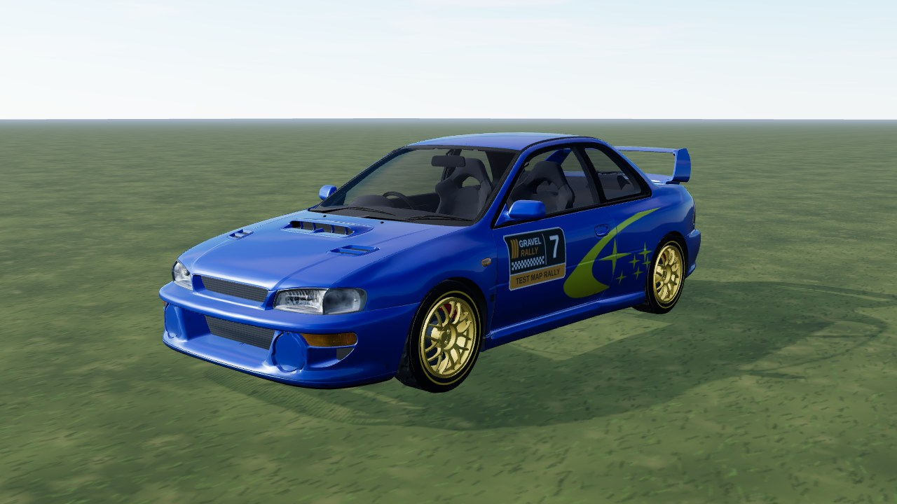
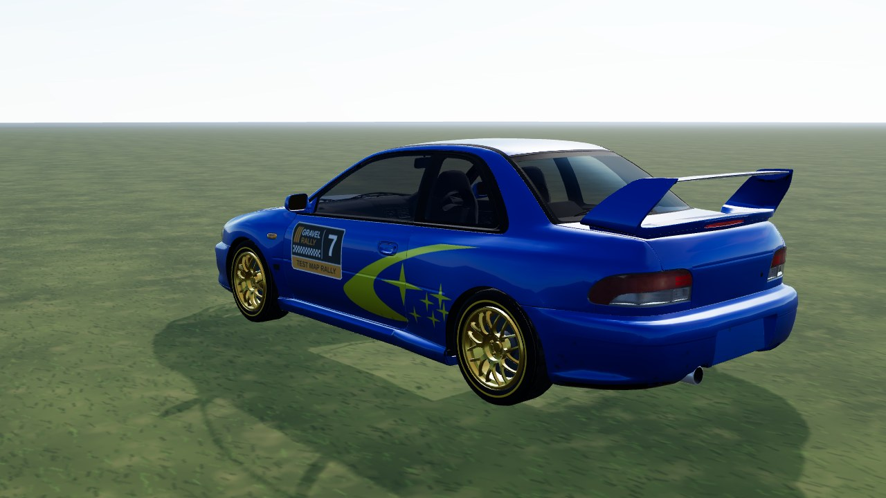
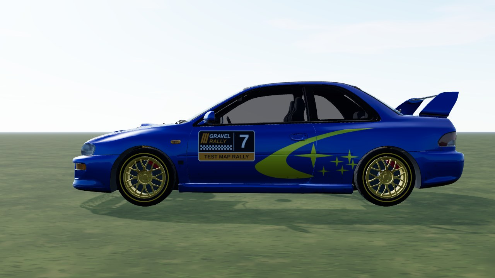

# Subaru WRX STI 22B (`subie_22b`)

A blue 22B-style widebody rally coupe (bonnet scoop, big wing, mudflaps) with a yellow side swoosh with two stripes. Body, glass, 3D lamps, exhaust, the gold mesh alloy and the cockpit (right-hand drive, seen through
the tinted glass) are converted from 007's **CC BY 4.0** "1998 Subaru Impreza 22B STi" Sketchfab model. Specs follow
the 22B: 2.2 l turbo flat-four (~280 PS / 206 kW at 6000 rpm, 363 Nm at 3200 rpm), five-speed box, permanent AWD with a rear
bias, 1,270 kg ([STI](https://www.sti.jp/en/roadcars/1998/impreza-22b.html)). Tyres 235/40 R17 (the real size), 215/55 R16 on
gravel. The paint is a metallic mica blue (`gltf.metallic`) with dust and road spray towards the sills.



|                                                |                               |
| ---------------------------------------------- | ----------------------------- |
|  |  |

```bash
npm run dev     # /games/rally/car-viewer.html?car=subie_22b
```

## Files

| File                | What                                                                                   |
| ------------------- | -------------------------------------------------------------------------------------- |
| `subie-22b.ts`      | `CarDef`: drivetrain, tyres, set-ups, body-fitted hull, fallback body, glTF            |
| `livery.ts`         | body atlas painter: blue base, dark undercoat, yellow side swoosh, dust and road spray |
| `model.source.json` | GLB node -> part mapping, scale / offset, atlas layout (read at runtime)               |

`public/models/cars/subie_22b.glb` (+ `subie_22b_wheel.glb`, `subie_22b_lamps.png`) are the converted models, scaled to the game's wheelbase.
The download is an FBX export in centimetres, so `scripts/car-model/glb-orient.py --scale 100` turns it into metres before the
conversion (`model.source.json`); the raw file stays out of git (`sources/`, local only).

## Credits and licence

| What  | Source                                                                                                                                           | Licence               |
| ----- | ------------------------------------------------------------------------------------------------------------------------------------------------ | --------------------- |
| Model | ["1998 Subaru Impreza 22B STi" by 007](https://sketchfab.com/3d-models/1998-subaru-impreza-22b-sti-62ce498bf3204ccbb875c8682ccd87b2) (Sketchfab) | CC BY 4.0 (converted) |
| Specs | [STI Impreza 22B](https://www.sti.jp/en/roadcars/1998/impreza-22b.html)                                                                          | looked at only        |

Code: PolyForm Noncommercial 1.0.0. The body paint is replaced by our livery; the model's badges, logos and number plate are dropped.
