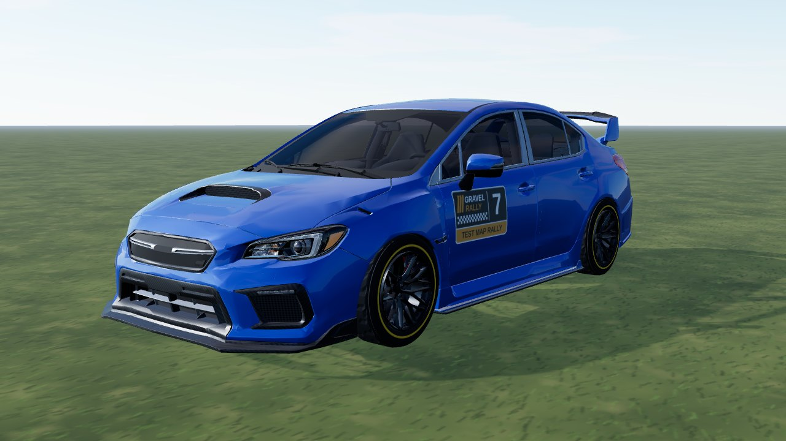
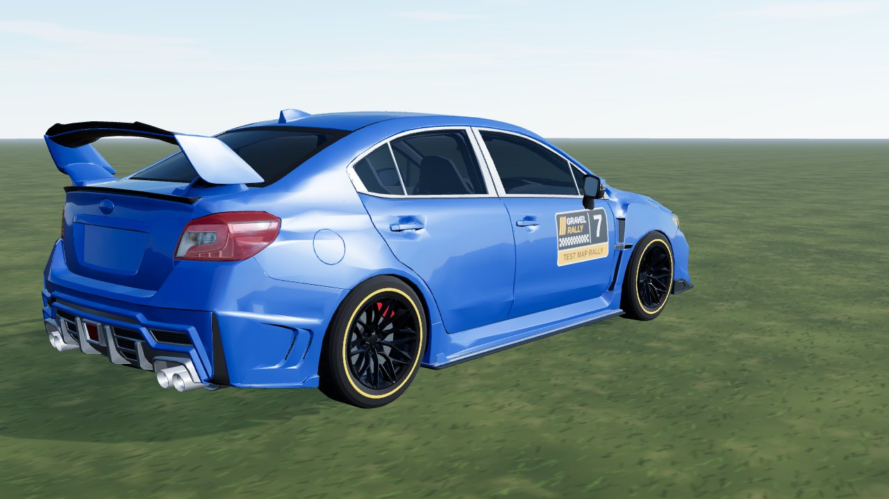
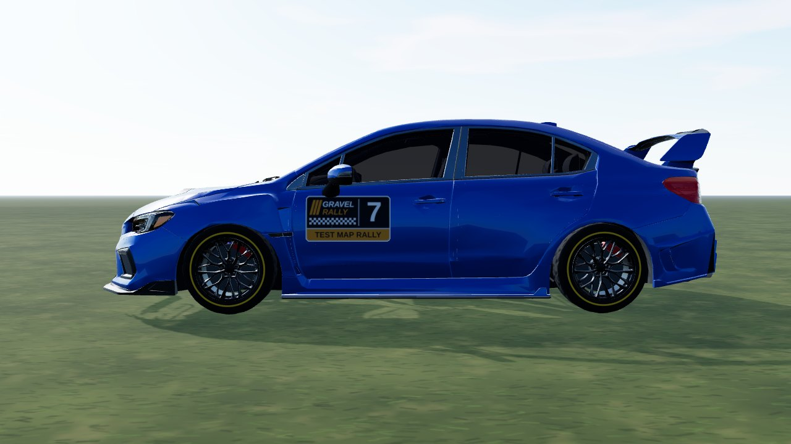

# Subaru WRX STI (`subie_wrx_sti`)

A 2019 WRX STI from a **CC BY Sketchfab model**, used as it comes: the model has no livery, so it is mapped to game parts by
material (a few box rules where one material holds two parts). In game it is **Subaru WRX STI**: AWD, 1540 kg, 2.5 turbo
flat-four, 6-speed. Test car (`hideInProd` in `CARS_LIST`).

- **Kept from the model:** the body kit, the cockpit (flat colours, simplified to its seats, wheel, dash and door cards) behind
  see-through glass, the head / tail lamps with the model's own lamp texture and the multi-spoke rim (de-cambered, centred on the hub).
- **Dropped:** tyres, brake discs, calipers and the engine bay, the badges, the lettering and the plates.
- **Paint (ours):** one flat blue, other seeds recolour it; window frames in brushed aluminium (`satin` part).



|                                                |                               |
| ---------------------------------------------- | ----------------------------- |
|  |  |

```bash
npm run dev     # /games/rally/car-viewer.html?car=subie_wrx_sti
```

## Stats (game engine configuration)

Power, torque and mass follow the published STI figures; gearing, grip and brakes are estimates.

| Stat       | Value                                                           |
| ---------- | --------------------------------------------------------------- |
| Drivetrain | AWD 41 : 59, 6-speed, final drive 3.9 (short / medium / long)   |
| Engine     | 2.5 turbo flat-four, 393 Nm at 4000 rpm, 305 hp                 |
| Mass       | 1540 kg, wheelbase 2.65 m, track 1.59 / 1.58 m                  |
| Wheels     | 245/40 R18 tarmac, 235/45 R17 mixed, 225/55 R16 gravel          |
| Aids       | ABS, TC like every car (ABS can be switched off in the options) |

## Files

| File                | What                                                                    |
| ------------------- | ----------------------------------------------------------------------- |
| `subie-wrx-sti.ts`  | `CarDef`: physics, hull fitted to the model, rim, glass tint, glTF      |
| `profile.ts`        | boxy side profile baked from the GLB: fallback body and city street car |
| `livery.ts`         | body atlas painter: flat paint over a dark underside                    |
| `model.source.json` | converter settings (offset, atlas) and `gltf` rules (material -> part)  |

## Credits and licence

| What                      | Source                                                                                                                                             | Licence        |
| ------------------------- | -------------------------------------------------------------------------------------------------------------------------------------------------- | -------------- |
| Body, cockpit, lamps, rim | ["2019 Rowen Subaru WRX STI" by Car design, Sketchfab](https://sketchfab.com/3d-models/2019-rowen-subaru-wrx-sti-dfd3b419f6c84f52920476549c403f17) | **CC BY 4.0**  |
| Specification             | [Subaru - 2021 WRX brochure (PDF)](https://www.subaru.com/content/dam/subaru/downloads/pdf/brochures/2021/wrx/2021_WRX_Brochure.pdf)               | reference only |

Converted and repainted by us (attribution in `CarDef.credit`, `THIRD-PARTY.md`, `public/models/CREDITS.md`). The downloaded GLB
itself is not in the repository (`sources/` is git-ignored); only the converted `subie_wrx_sti.glb`, `subie_wrx_sti_wheel.glb` and
`subie_wrx_sti_lamps.png` ship.
