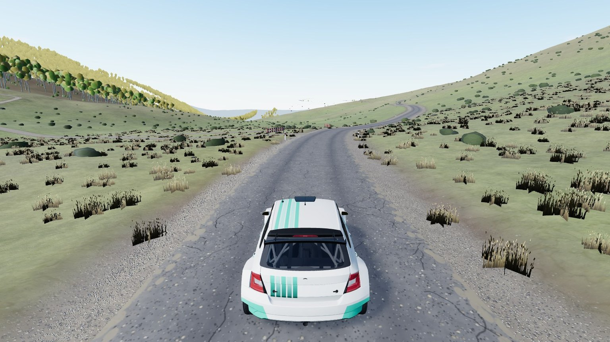
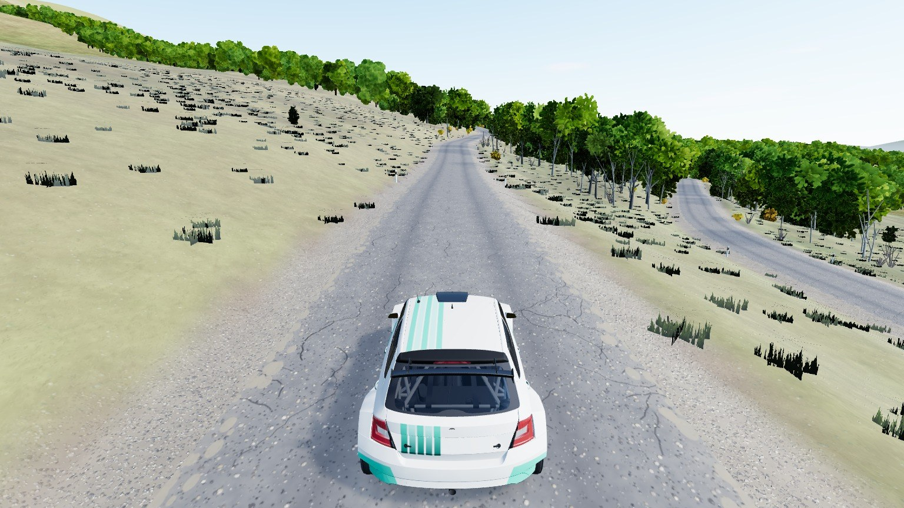

# Galichica

Real-world mountain map in Galichica national park, North Macedonia: the pass road over Galichica between Lake Ohrid
(693 m) and Lake Prespa (847 m), over the Livada pass (1 570 m), with both lakes and the mountains around them as the
backdrop. One map, three stages on the same road (map id `galichica`; Galichica West is released, the other two stages are test content: dev server only).



|                                                         |
| ------------------------------------------------------- |
|  |

| Stage                | Id               | From -> to                                          | Length  |
| -------------------- | ---------------- | --------------------------------------------------- | ------- |
| Galichica West       | `galichica_west` | park entrance above Lake Ohrid -> Magaro parking    | 14.7 km |
| Galichica East       | `galichica_east` | above Lake Prespa -> Magaro parking                 | 12.7 km |
| From Prespa to Ohrid | `prespa_ohrid`   | above Lake Prespa -> over the pass -> park entrance | 27.4 km |

Each start has a small parc fermé on a lay-by behind it (6 cars on the Ohrid side, 5 on the Prespa side; `service-park.ts`).

Narrow tarmac with switchbacks on both sides; a closed canopy of bright-green hornbeam / oak coppice over hazel and
juniper low down, flowering yellow broom on the road cuttings, beech forest on the mid slopes, karst
pasture with dwarf juniper on the top. Only the pass road and the roads round the stage ends are imported; side tracks
meeting the stage road are closed with barriers on each stage.

```bash
npm run dev     # /games/rally/?stage=galichica_west&mute=1
                # /games/rally/map-viewer.html?map=galichica&stage=prespa_ohrid
```

## Data and credits

| What                   | Source                                                                                                                                                                                                | Licence                                                                                      |
| ---------------------- | ----------------------------------------------------------------------------------------------------------------------------------------------------------------------------------------------------- | -------------------------------------------------------------------------------------------- |
| Stage start / finish   | Google Maps routes ([west](https://www.google.com/maps/dir/40.9440267,20.789616/40.9537817,20.8289773), [east](https://www.google.com/maps/dir/40.9612712,20.8976721/40.9537817,20.8289773))          | the end points only                                                                          |
| Park facts             | [Galichica National Park](https://nationalparksmacedonia.com/en/parks/galicica)                                                                                                                       | stage descriptions, reference only                                                           |
| Roads, lakes, woods    | [OpenStreetMap](https://www.openstreetmap.org/copyright) via the [Overpass API](https://overpass-api.de/)                                                                                             | ODbL, © OpenStreetMap contributors                                                           |
| Elevation, far horizon | [AWS Terrain Tiles](https://registry.opendata.aws/terrain-tiles/)                                                                                                                                     | [attributions](https://github.com/tilezen/joerd/blob/master/docs/attribution.md)             |
| Land cover             | [ESA WorldCover 2021](https://esa-worldcover.org/)                                                                                                                                                    | CC BY 4.0, © ESA WorldCover project 2021 / contains modified Copernicus Sentinel data (2021) |
| Road asphalt           | [Asphalt 04 (Poly Haven)](https://polyhaven.com/a/asphalt_04), by Sergej Majboroda and Jenelle van Heerden                                                                                            | CC0                                                                                          |
| Service park kit       | [NVIDIA SimReady Assets](https://huggingface.co/datasets/nvidia/simready-assets) (service park: tool chest, tyre rack, trolley jack, flood light, extinguisher, wheelbarrow, hand truck, ladder, bin) | CC BY 4.0                                                                                    |
| Service park props     | [Poly Haven](https://polyhaven.com/models) (service park table and chairs, generator: Outdoor Table Chair Set 01, Portable Generator)                                                                 | CC0                                                                                          |

The baked map files (`*.json`, `buildings.csv`, stage cards) are a derived database of OpenStreetMap and stay under the
ODbL.
