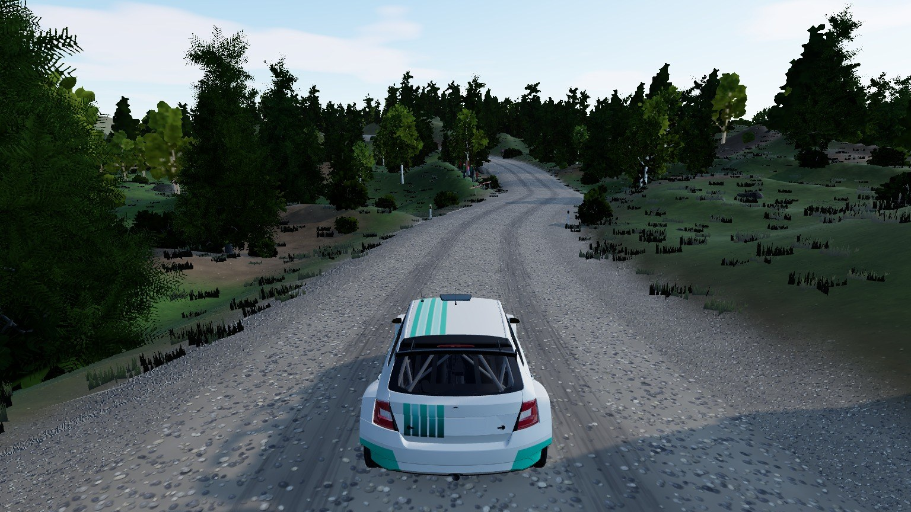

# Test Map

Procedural ~1.8 km forest gravel stage for physics work: a straight run-up with a small parc fermé (4 cars) beside it,
fast sweepers, S-bends, hairpin, crest jump, flat test pad (`?spawn=pad`). Everything is generated from `map.ts` (noise
terrain, hand-placed road points, scatter rules); `service-park.ts` is the parc fermé lot.

| File              | What                                    |
| ----------------- | --------------------------------------- |
| `map.ts`          | the whole map (pure data)               |
| `service-park.ts` | the parc fermé lot and its pad          |
| `README.md`       | this file - external links / files used |

## External sources

None - fully procedural (seed 1337), so there is no `sources/maps/test/` folder. If reference photos, textures or
data are ever used for this map, put the files in `sources/maps/test/` and add a row:

| Link / file | Used for | Licence / attribution | Added |
| ----------- | -------- | --------------------- | ----- |
| -           | -        | -                     | -     |

## Tools

| Tool       | Link                                                    |
| ---------- | ------------------------------------------------------- |
| Map viewer | `/games/rally/map-viewer.html?map=test`                 |
| Play       | `/games/rally/?stage=test&spawn=start` (or `spawn=pad`) |
