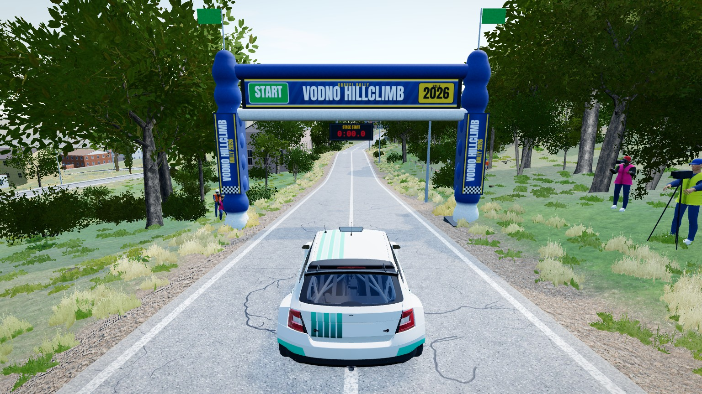
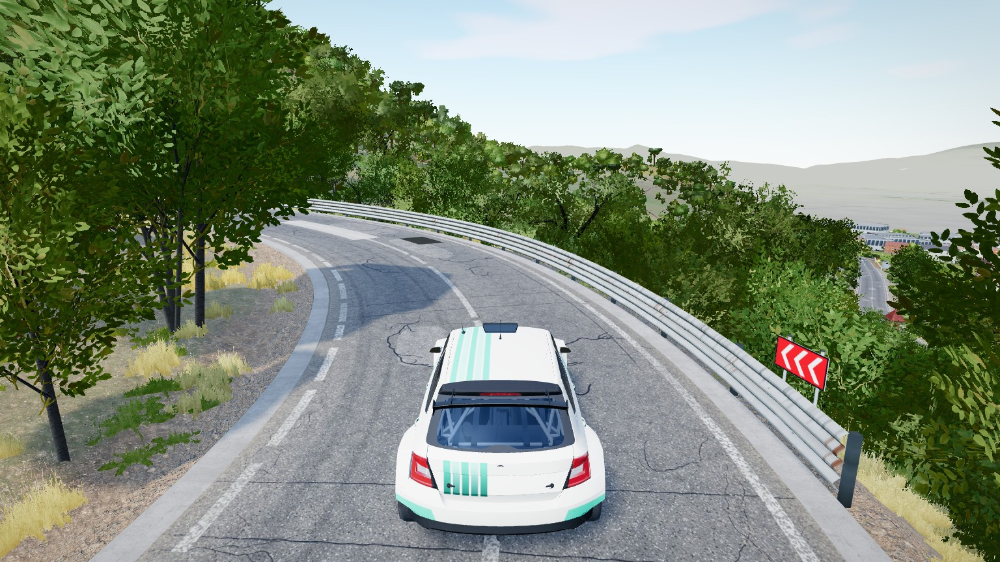
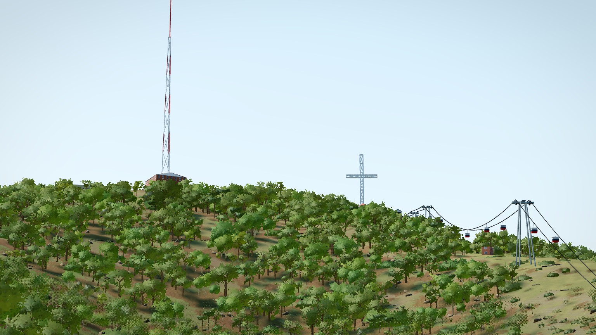

# Vodno Hillclimb

Real hillclimb on Mount Vodno above Skopje, North Macedonia: 4.0 km and 220 m of climb from the Vodno neighbourhood up the
hairpins of the north face, through oak and pine woods, to Sredno Vodno. The Millennium Cross, the antenna mast and the cable car
stand on the ridge above the road; the 6 x 4 km round it (streets, houses, side roads) is in the world, with the Skopje valley
as the backdrop. Map and stage id `vodno`.



|                                            |                                                               |
| ------------------------------------------ | ------------------------------------------------------------- |
|       |      |
| the hairpins above the suburb, guard rails | the Millennium Cross, the mast and the cable car on the ridge |

Narrow tarmac with white edge and centre lines (old, patched and cracked below the big hairpin, fresh above it; flush pale kerb strips), switchbacks and guard rails, oak and hornbeam woods with blocks of black pine plantation (from winter satellite scenes), black locust on the lower slopes, the woods in layers with the trees at the road leaning out over it;
the road widens to three lanes at the first crossroad (a left-turn lane beside the straight-ahead one), with a concrete retaining wall on its right. Locust and walnut trees with bramble
and scrub close in on the road as a wall of growth where the real one has it, cypresses stand in the church yards. Side streets meeting
the stage road are closed with barriers.

Landmarks (OpenStreetMap plans, rough shapes in the style of the Ajvatovci hilltop church, ai-generated in `landmarks/`): the
66 m Millennium Cross and the 155 m mast, the cable car with moving cabins, the mountain lodge, the churches of Sredno Vodno
(beside the finish) and Gorno Nerezi, the lookout tower, the Markovi Kuli ruins, the restaurant beside the Sredno Vodno church, and
three car parks beside the stage road (the
Sredno Vodno one with its flag, lamps, a timber gazebo and watch towers; the Vidikovec with a grass island, a lattice lookout tower
and rusted guard rails on its approach), the wooden gate past the first crossroad (two log towers, a notice board and a shelter) and two blocks
of flats behind one street wall on the start street, and a brick-and-concrete hotel behind the side street at the first crossroad (its forecourt on the road, road
wall, sign boards), and the gravel trail car park at the hairpin above Sredno Vodno with the hiking trail's stone posts, a shelter and
picnic tables under tall pines, sand and crushed-stone piles closing the side road and a gazebo on the grass island of the hairpin; another gazebo stands on the gravel pull-off at 2.3 km, where the hiking trail leaves. Rock cuts with
layered faces line the road where it is dug into the hill, stony fill banks and guard rails where it drops away, and the
OpenStreetMap footpaths, benches, shelters, boards and gates near the road dot the woods. Concrete culverts with headwalls carry
two gullies under the road (1.7 and 3.3 km): OpenStreetMap maps none here, so they come from the elevation data (`culverts.json`)
and are kept only where the owner confirmed a real culvert. Skopje's skyline stands on the horizon: the 70 m MRT tower and the 136 m Cevahir Sky City
slabs (extruded OpenStreetMap footprints).

```bash
npm run dev     # /games/rally/?stage=vodno&mute=1
                # /games/rally/map-viewer.html?map=vodno&stage=vodno
```

## Data and credits

| What                                   | Source                                                                                                                                                                                                                                                                                                     | Licence                                                                                                      |
| -------------------------------------- | ---------------------------------------------------------------------------------------------------------------------------------------------------------------------------------------------------------------------------------------------------------------------------------------------------------- | ------------------------------------------------------------------------------------------------------------ |
| Stage start / finish                   | [Google Maps route](https://www.google.com/maps/dir/41.9808131,21.4219566/41.9752441,21.4096439)                                                                                                                                                                                                           | the end points only                                                                                          |
| Roads, buildings, cable car, landmarks | [OpenStreetMap](https://www.openstreetmap.org/copyright) via the [Overpass API](https://overpass-api.de/)                                                                                                                                                                                                  | ODbL, © OpenStreetMap contributors                                                                           |
| More building footprints               | [Microsoft Global ML Building Footprints](https://github.com/microsoft/GlobalMLBuildingFootprints)                                                                                                                                                                                                         | ODbL                                                                                                         |
| Elevation of the mountain              | [Copernicus DEM GLO-30](https://doi.org/10.5069/G9028PQB) via OpenTopography                                                                                                                                                                                                                               | © DLR e.V. 2010-2014, © Airbus Defence and Space GmbH 2014-2018, provided under COPERNICUS by the EU and ESA |
| Elevation of the town, far horizon     | [AWS Terrain Tiles](https://registry.opendata.aws/terrain-tiles/)                                                                                                                                                                                                                                          | [attributions](https://github.com/tilezen/joerd/blob/master/docs/attribution.md)                             |
| Land cover                             | [ESA WorldCover 2021](https://esa-worldcover.org/)                                                                                                                                                                                                                                                         | CC BY 4.0                                                                                                    |
| Tree positions and canopy              | [Meta and World Resources Institute, High Resolution Canopy Height Maps](https://registry.opendata.aws/dataforgood-fb-forests/) (imagery © Maxar 2018-2020)                                                                                                                                                | CC BY 4.0                                                                                                    |
| Leaf type of the woods                 | [Copernicus Sentinel-2 L2A](https://registry.opendata.aws/sentinel-2-l2a-cogs/)                                                                                                                                                                                                                            | contains modified Copernicus Sentinel data (2025)                                                            |
| Landmark facts                         | [Millennium Cross](https://en.wikipedia.org/wiki/Millennium_Cross), [Vodno](https://en.wikipedia.org/wiki/Vodno), [MRT Center](https://en.wikipedia.org/wiki/MRT_Center), [Cevahir Towers](https://en.wikipedia.org/wiki/Cevahir_Towers) (Wikipedia)                                                       | reference only, nothing copied                                                                               |
| Roadside details                       | YouTube videos of Vodno, the owner's photos                                                                                                                                                                                                                                                                | used as reference only, nothing copied                                                                       |
| Service park kit                       | [NVIDIA SimReady Assets](https://huggingface.co/datasets/nvidia/simready-assets) (service park: tool chest, tyre rack, trolley jack, flood light, extinguisher, wheelbarrow, hand truck, ladder, bin, axle stands, pail, tyre stillage)                                                                    | CC BY 4.0                                                                                                    |
| Side-road sand and stone piles         | [Poly Haven](https://polyhaven.com/textures) (Dense Sand, Gravel Floor 02 scans)                                                                                                                                                                                                                           | CC0                                                                                                          |
| Road-cut rock faces                    | [Poly Haven](https://polyhaven.com/a/cliff_side) (Cliff Side scan, toned)                                                                                                                                                                                                                                  | CC0                                                                                                          |
| Service park and forest-floor props    | [Poly Haven](https://polyhaven.com/models) (service park table and chairs, generator, jerrycans, power poles: Outdoor Table Chair Set 01, Portable Generator, Metal Jerrycan Green, Modular Electricity Poles; forest floor: Tree Stump 01 / 02, Dead Tree Trunk / 02, Dry Branches Medium 01, Pine Roots) | CC0                                                                                                          |
| Grass, weeds and reeds                 | [Poly Haven](https://polyhaven.com/models) (plant scans: Grass Medium 01 / 02, Nettle Plant, Dandelion 01, Celandine 01, Weed Plant 02)                                                                                                                                                                    | CC0                                                                                                          |
| Tree leaf photos                       | LOLIPOP (Sketchfab account lolipop_1707): the leaf textures of its pine, oak, maple, birch, lilac and bush packs, cut into the generated trees' leaf photos                                                                                                                                                | CC BY 4.0                                                                                                    |

The baked map files (`*.json`, `buildings.csv`, the stage card in `preview/`) are a derived database of OpenStreetMap and stay
under the ODbL (`canopy.json` also carries the canopy height maps' CC BY 4.0 attribution). The cross, mast, pylons and all landmark models are procedural (no logos or lettering).
