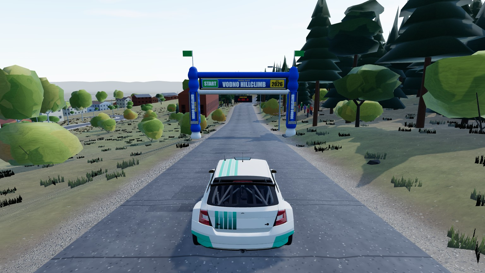
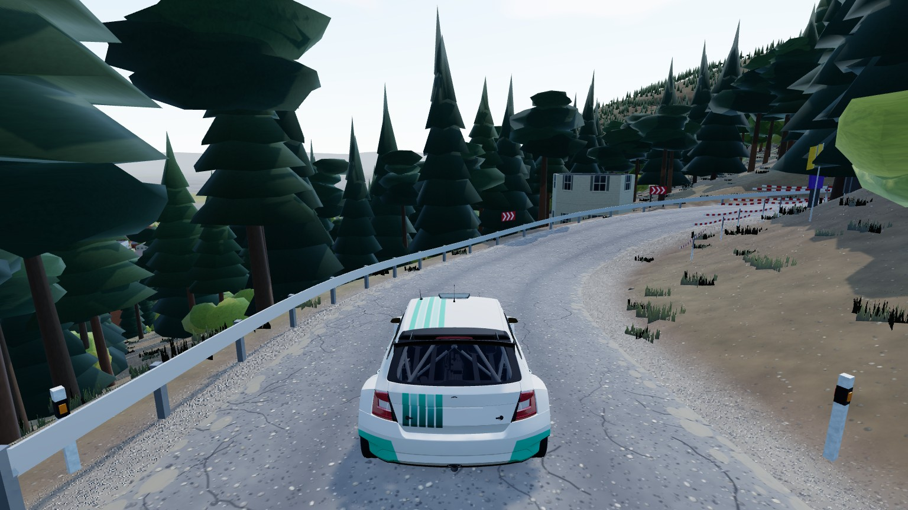
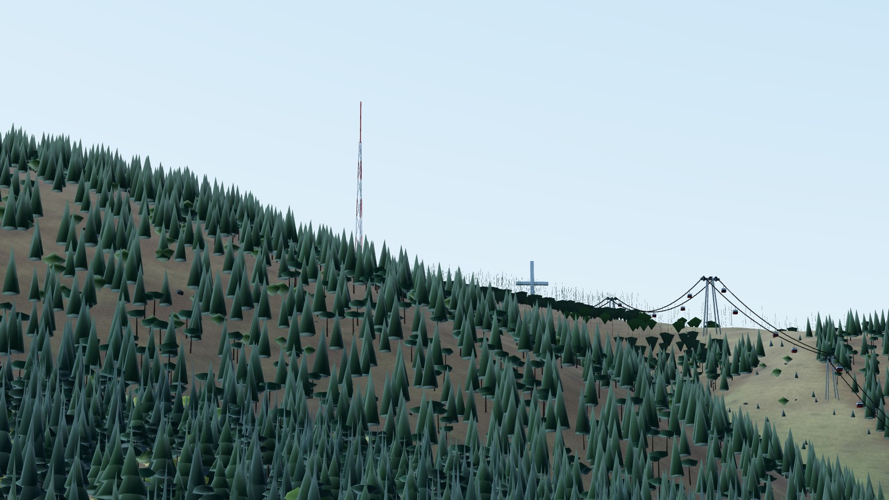

# Vodno Hillclimb

Real hillclimb on Mount Vodno above Skopje, North Macedonia: 4.0 km and 220 m of climb from the Vodno neighbourhood up the
hairpins of the north face, through oak and pine woods, to Sredno Vodno. The Millennium Cross, the antenna mast and the cable car
stand on the ridge above the road; the 6 x 4 km round it (streets, houses, side roads) is in the world, with the Skopje valley
as the backdrop. Map and stage id `vodno`.



|                                            |                                                               |
| ------------------------------------------ | ------------------------------------------------------------- |
|       |      |
| the hairpins above the suburb, guard rails | the Millennium Cross, the mast and the cable car on the ridge |

Narrow tarmac with white edge and centre lines, switchbacks and guard rails, oak and hornbeam woods with blocks of black pine plantation (from winter satellite scenes), black locust on the lower slopes;
the road widens to three lanes at the first crossroad (a left-turn lane beside the straight-ahead one), with a concrete retaining wall on its right. Locust and walnut trees with bramble
stand back from the lower road, cypresses stand in the church yards. Side streets meeting
the stage road are closed with barriers.

Landmarks (OpenStreetMap plans, rough shapes in the style of the Ajvatovci hilltop church, ai-generated in `landmarks/`): the
66 m Millennium Cross and the 155 m mast, the cable car with moving cabins, the mountain lodge, the churches of Sredno Vodno
(beside the finish) and Gorno Nerezi, the lookout tower, the Markovi Kuli ruins, the restaurant beside the Sredno Vodno church, and
three car parks beside the stage road (the
Sredno Vodno one with its flag, lamps, a timber gazebo and watch towers; the Vidikovec with a grass island, a lattice lookout tower
and rusted guard rails on its approach), the wooden gate past the first crossroad (two log towers, a notice board and a shelter) and two blocks
of flats behind one street wall on the start street, and a brick-and-concrete hotel behind the side street at the first crossroad (its forecourt on the road, road
wall, sign boards). Skopje's skyline stands on the horizon: the 70 m MRT tower and the 136 m Cevahir Sky City
slabs (extruded OpenStreetMap footprints).

```bash
npm run dev     # /games/rally/?stage=vodno&mute=1
                # /games/rally/map-viewer.html?map=vodno&stage=vodno
```

## Data and credits

| What                                   | Source                                                                                                                                                                                                                                               | Licence                                                                          |
| -------------------------------------- | ---------------------------------------------------------------------------------------------------------------------------------------------------------------------------------------------------------------------------------------------------- | -------------------------------------------------------------------------------- |
| Stage start / finish                   | [Google Maps route](https://www.google.com/maps/dir/41.9808131,21.4219566/41.9752441,21.4096439)                                                                                                                                                     | the end points only                                                              |
| Roads, buildings, cable car, landmarks | [OpenStreetMap](https://www.openstreetmap.org/copyright) via the [Overpass API](https://overpass-api.de/)                                                                                                                                            | ODbL, © OpenStreetMap contributors                                               |
| More building footprints               | [Microsoft Global ML Building Footprints](https://github.com/microsoft/GlobalMLBuildingFootprints)                                                                                                                                                   | ODbL                                                                             |
| Elevation, far horizon                 | [AWS Terrain Tiles](https://registry.opendata.aws/terrain-tiles/)                                                                                                                                                                                    | [attributions](https://github.com/tilezen/joerd/blob/master/docs/attribution.md) |
| Land cover                             | [ESA WorldCover 2021](https://esa-worldcover.org/)                                                                                                                                                                                                   | CC BY 4.0                                                                        |
| Leaf type of the woods                 | [Copernicus Sentinel-2 L2A](https://registry.opendata.aws/sentinel-2-l2a-cogs/)                                                                                                                                                                      | contains modified Copernicus Sentinel data (2025)                                |
| Landmark facts                         | [Millennium Cross](https://en.wikipedia.org/wiki/Millennium_Cross), [Vodno](https://en.wikipedia.org/wiki/Vodno), [MRT Center](https://en.wikipedia.org/wiki/MRT_Center), [Cevahir Towers](https://en.wikipedia.org/wiki/Cevahir_Towers) (Wikipedia) | reference only, nothing copied                                                   |

The baked map files (`*.json`, `buildings.csv`, the stage card in `preview/`) are a derived database of OpenStreetMap and stay
under the ODbL. The cross, mast, pylons and all landmark models are procedural (no logos or lettering).
