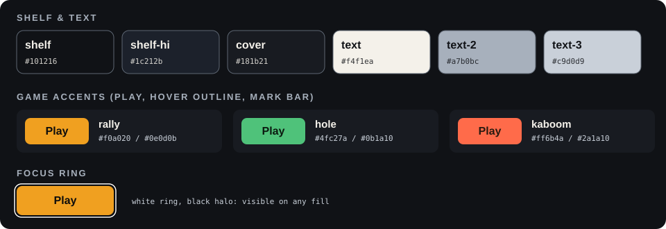

# Portal style guide

The look of the home page ("Game Shelf"): a quiet graphite shelf with one cover per game. Each cover brings its own title
face, accent colour and picture; the portal adds none of its own except the three-bar mark. All values live in
[`ui-tokens.css`](ui-tokens.css); `portal.css` uses `var(--pt-*)` only, so a change of look starts there.

## Principles

- **The shell is neutral.** No slant, no clay, no press-down lip on the portal. Those belong to the games (see their style guides).
- **Each game introduces itself.** Title face (its `wordmark.svg`), one accent with its on-accent text colour, and its screenshot.
- **One primary action per cover.** Play is the only button; the whole cover is its click target. Developer tools sit behind a quiet "Tools" toggle.
- **Dark first.** Every game opens on a dark screen, so the page never flashes white between portal and game.
- **Never hide an explanation by screen size.** A phone shows one cover per row and keeps the blurb; a phone held sideways
  shows every cover in one row and the Play buttons without scrolling (check 915x412 and 1280x720).

## Colour

|                                  | Token                               | Value                         | Use                                                             |
| -------------------------------- | ----------------------------------- | ----------------------------- | --------------------------------------------------------------- |
|    | `--pt-shelf` / `-hi` / `--pt-cover` | `#101216` `#1c212b` `#181b21` | page background (a soft top glow), cover card                   |
|      | `--pt-text` / `-3` / `-2`           | `#f4f1ea` `#c9d0d9` `#a7b0bc` | titles, blurb, labels and footer (7.9:1 or better on the cover) |
|    | `--ga` / `--ga-on` (Gravel Rally)   | `#f0a020` / `#0e0d0b`         | amber: Play, hover outline, first bar of the mark               |
|      | Hole Island                         | `#4fc27a` / `#0b1a10`         | green                                                           |
|  | 3, 2, 1 Kabooom                     | `#ff6b4a` / `#2a1a10`         | tomato                                                          |
|    | Ballistic Chess                     | `#4cc9ff` / `#0c121a`         | cyan                                                            |
|    | `--pt-ring` / `--pt-halo`           | `#ffffff` / `#000000`         | focus ring: white with a black halo, visible on any fill        |

A game's accent is set in its `game.json` (`accent`, `onAccent`) and lands on its card as `--ga` / `--ga-on`. Each accent
is 6:1 or better against the shelf and each on-accent text is 5.9:1 or better on its accent (`tests/portal-manifest.test.ts`
checks 4.5:1). `--pt-accent` is only the fallback for a game without one.

## Type

- **Body:** Atkinson Hyperlegible 400 / 700 (drawn for low-vision legibility): blurb, buttons, footer.
- **Labels:** IBM Plex Mono 500, uppercase, small letter-spacing: the "genre · inputs" line and the version.
- **Titles:** not live text but outlined SVGs, so the portal loads no game fonts: the portal's own
  [`wordmark.svg`](wordmark.svg) (Archivo 800, width 125), and per game `src/games/<id>/wordmark.svg` next to `thumbnail.jpg`
  (Gravel Rally: Barlow Condensed 800 italic; Hole Island: Fredoka 700; 3, 2, 1 Kabooom: Grandstander 800; Ballistic Chess:
  Chakra Petch 700, upper case).
  `scripts/portal/wordmarks.py` makes them; a game without one shows its plain title.
- Fonts are self-hosted (latin woff2, [`fonts/`](fonts/), SIL Open Font License, see [`THIRD-PARTY.md`](../../THIRD-PARTY.md)).
- Sizes: cover title 30-40 px (24 px sideways on a phone), body 15 px, buttons 16 px, labels 12 px, footer 13 px. Nothing below 10 px.

## Components

- **Cover** (`.cover`): radius 12 px, picture at 16:10 (16:9 on phones) with a bottom fade and the title over it, then the
  label line, the blurb and the actions at the bottom (one row height across covers). Hover and focus lift it 4 px and draw a
  3 px outline in the game's accent; nothing moves under `prefers-reduced-motion`.
- **Play** (`.play`): radius 8 px, the game's accent fill, on-accent text, a small play triangle. Its `::after` covers the card.
- **Tools** (`.tools-toggle`, `.tools-list`): a text button that reveals the game's tool pages as text links (map viewer, car viewer ...).
- **Mark** (`.portal-bars`): one bar per game in its accent, in front of the wordmark.
- **Outside game** (`url` in `game.json`): the same cover; Play opens the game's own site in a new tab and ends in ↗.
- **Picture:** `thumbnail.jpg` (1280x720) with `thumbnail-640.jpg` (640x360) as its `srcset`; F9 in the game saves both.
- **Footer:** the site tagline with the owner; About (the README), Source and the licence as links, and "Privacy & cookies" where the banner is on.
- **Cookie banner** (`shared/consent.css`): the portal tokens, with the same values as fallbacks on game pages (which do not load them).
- **Link preview:** `public/og-image.jpg`, 1200x630, the shelf without footer; retake it with `scripts/portal/og-image.mjs` when the look changes.

## Behaviour

- Arrow keys and the d-pad move focus between Play and Tools (`shared/pad-nav.ts`); the menu tick plays on those moves only, not on mouse hover.
- Tab and pad focus look the same (the white ring with a black halo).

## Adding a game

1. `game.json`: `genre`, `inputs`, `version`, a one-line `description`, and `accent` / `onAccent` (check contrast: 6:1 on the shelf, 4.5:1 for the text on the accent).
2. `thumbnail.jpg` + `thumbnail-640.jpg` (F9 in the game) and a `wordmark.svg` in the game's own title face; add its colours to the palette image above.
3. Check 1280x720 and 915x412, and keyboard and pad focus.
